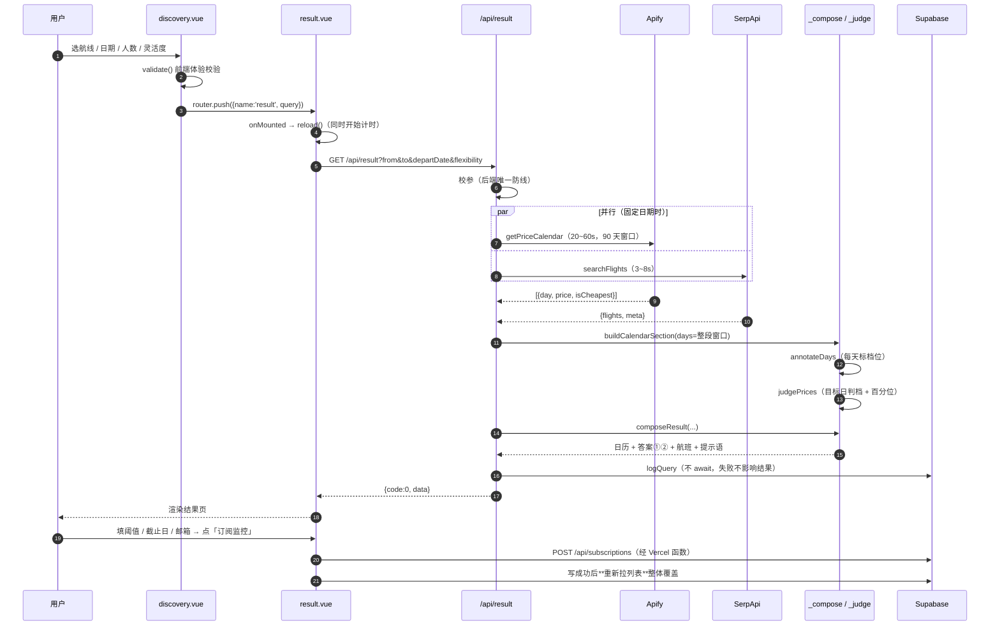
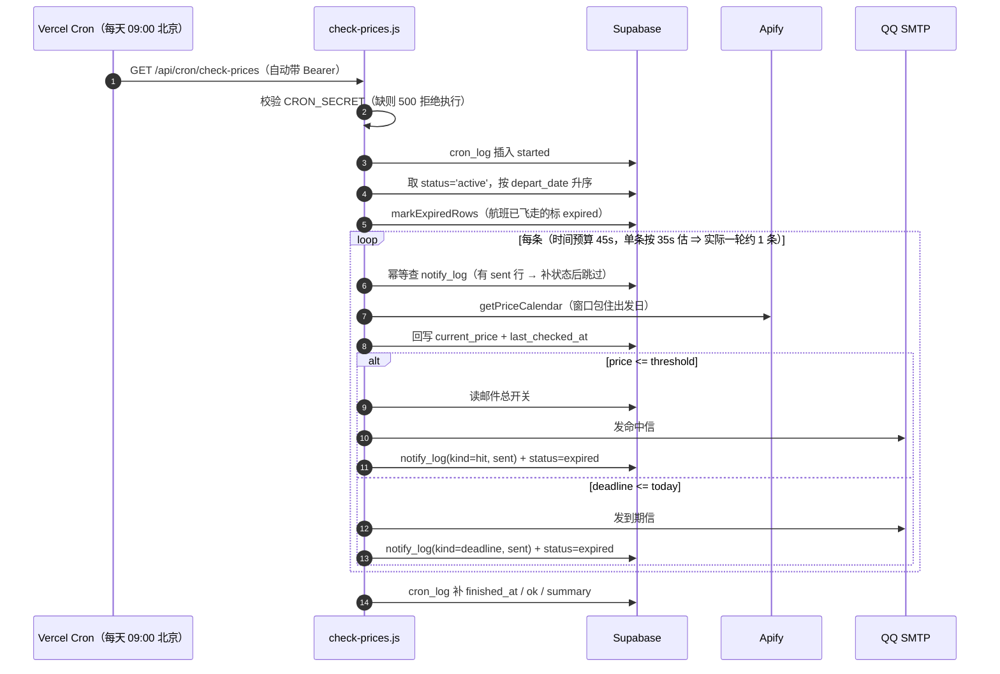

# FlyOrWait · 该买机票吗

> 输入航线和日期，用「未来 90 天的每日最低价」判断**现在该买还是再等等**；
> 设一个目标价，跌破时发一封邮件；到决策截止日还没跌到，也发一封收尾。

一个真实在跑的机票决策工具，部署地址 `fly-or-wait.vercel.app`。
不是比价网站（不卖票、不下单），只回答两个问题。

---

## 目录

- [一、这个项目是什么](#一这个项目是什么)
- [二、技术栈与外部依赖](#二技术栈与外部依赖)
- [三、整体架构](#三整体架构)
- [四、后端逐函数拆解](#四后端逐函数拆解)
- [五、前端逐函数拆解](#五前端逐函数拆解)
- [六、数据模型](#六数据模型)
- [七、踩过的坑](#七踩过的坑)
- [八、已知缺口与技术债](#八已知缺口与技术债)
- [九、本地开发 · 部署 · 排错](#九本地开发--部署--排错)
- [十、面试问答卡](#十面试问答卡)
- [十一、往 Agent 演进](#十一往-agent-演进)

---

## 一、这个项目是什么

### 1.1 它回答的两个问题

| 问题 | 谁回答 | 数据从哪来 |
|---|---|---|
| ① **哪天出发最便宜？** | `api/_compose.js::buildDateAnswer` | 同一份价格日历，按灵活度切窗口扫描 |
| ② **现在这个价该不该买？** | `api/_judge.js::judgePrices` | 未来窗口内的 P25 / P75 分位 |

第 ② 个问题是产品的主线。它的判断逻辑只有一句话：

```
目标价 <= P25  → low      便宜，建议现在买
目标价 >= P75  → high     偏贵，建议再等等
其余           → typical  正常，可以买
```

**为什么用「未来窗口」而不是「历史价格」**：Google 的 `price_level` 拿过去 62 天比，回答的是「这个价比历史上贵吗」；
我们拿未来 90 天比，回答的是「这个价比接下来别的出发日贵吗」。用户真正要决定的是「现在买还是等」，后者更直接相关。
港澳台和国际航线两边都有，可以互为佐证；纯内地航线 Google 不返回 `price_level`，只有我们这一套。

### 1.2 功能清单（截至 2026-10-26）

| 模块 | 功能 | 状态 |
|---|---|---|
| 查询 | 单程 / 往返、21 个机场（18 国内 + 3 港澳台）、人数 1~9 | ✅ |
| 查询 | 日期灵活度：固定 / ±3 天 / ±7 天 / 整月最优 | ✅ |
| 结果 | 整屏等待态（含已等待秒数，后端实测 20~60 秒） | ✅ |
| 结果 | 答案①：最优出发日 + 省多少钱 + 该日的百分位 | ✅ |
| 结果 | 答案②：档位 + 百分位 + 典型区间 + 「怎么等」三件套 + 推理链 | ✅ |
| 结果 | 价格日历：整月、按档位上色、标出所选日、可折叠 | ✅ |
| 结果 | 航班列表：实时价、当天最低标记、点「盯价」指定基准航班 | ✅ |
| 结果 | 订阅卡片：阈值 / 决策截止日 / 通知邮箱，按钮带提交中态 | ✅ |
| 订阅 | 列表按 active → paused → expired 排序；最近价格 + 抓价时间 | ✅ |
| 订阅 | 编辑态（阈值 / 邮箱 / 截止日一起改）、暂停 / 恢复、取消 | ✅ |
| 订阅 | 通知记录表（**独立于订阅存在**，订阅删光也照样显示） | ✅ |
| 设置 | 默认通知邮箱（失焦自动保存 + 重置）、邮件总开关、本月查询次数 | ✅ |
| 定时 | 每天 09:00（北京）Cron 比价，命中 / 到期发信，**同一订阅只发一次** | ✅ 代码完成，端到端待验收 |
| 可观测 | `cron_log` 运行流水：跑没跑、跑完没、失败原因 | ✅ 代码完成；建表后生效 |

### 1.3 三条产品红线

这三条不是风格偏好，是**写进代码注释里的硬约束**，违反任何一条都算 bug：

1. **不编造**。拿不到数据就不出结论（`timingAnswer` 可以是 `null`），日历格子没报价就显示「—」，
   到期信里**绝不能写「之后不会降价了」**（我们没有未来数据）。
2. **不静默降级**。不支持商务舱就返回 400 明确拒绝，而不是按经济舱算完还假装是商务舱数据。
   不合法的 `id` 就报「无效的订阅 ID」，而不是让数据库抛 PG 错误再兜成 500。
3. **UI 提供的选项 ≤ 后端真实实现**。多一个选项就是一处静默错报。

### 1.4 一次使用的完整流程



订阅之后的链路是另一条：



---

## 二、技术栈与外部依赖

### 2.1 全貌

| 层 | 选型 | 版本 | 干什么 |
|---|---|---|---|
| 视图 | Vue 3（`<script setup>` + Composition API） | ^3.5.42 | 四个页面 |
| 构建 | Vite | ^8.2.2 | 开发服务器 + 打包 |
| 路由 | Vue Router（`createWebHistory`） | ^5.3.1 | 单页布局 + 子路由 |
| 状态 | Pinia（setup store 写法） | ^4.0.3 | 3 个 store |
| UI | Element Plus | ^2.14.7 | 下拉、日期、开关、消息框 |
| 请求 | axios | ^1.20.0 | 唯一网络出口 + 两个拦截器 |
| 后端 | Vercel Serverless Functions（Node ESM） | Node 22/24 | 根目录 `api/**.js`，目录即路由 |
| 数据库 | Supabase（PostgreSQL + PostgREST） | supabase-js ^2.117 | 5 张表 |
| 邮件 | nodemailer + QQ 邮箱 SMTP | ^10.1.7 | 465/SSL |
| 价格日历 | Apify actor `lergassy~flight-price-calendar` | — | 抓 Google Flights 日历 |
| 航班列表 | SerpApi `engine=google_flights` | — | 实时航班 + 价格 |
| 备用源 | Sky Scrapper（RapidAPI） | — | 已降级，代码保留 |
| 部署 | Vercel Hobby | — | 静态 + 函数 + Cron |
| 工程 | ESLint 10 + oxlint + Prettier 3.9 | — | `format → lint → build` 三板斧 |

### 2.2 为什么是这些

**为什么 Serverless 而不是常驻后端**
订阅、Cron 都要跑在服务端读数据库，但项目没有服务器预算。Vercel 的 `api/` 目录「文件即路由」，
零配置起步；代价是要接受 60 秒函数上限——这个限制直接决定了很多设计（见坑 #12）。

**为什么 Supabase 而不是自建 MySQL**
只用到「几张表 + REST」，Supabase 给的是 Postgres + 自动生成的 PostgREST 接口，不用写一层 DAO。
后端用 secret key 直连，前端永远不碰数据库。

**为什么把 Sky 换成 Apify**（`api/_apify.js` 顶部的完整来由）
Sky 免费档实测 **20 次/月**，而「5 条订阅每天刷一次」就要 150 次/月，根本撑不住订阅功能。
Apify 侧：`$0.0002/行`、免费档 `$5/月` ⇒ 一条航线抓 90 天日历 = **$0.018**，量级完全不同。
Sky 降级为备选（`api/_sky.js` 保留，含 `SKY_REPLAY`）。

**为什么航班列表还留在 SerpApi**
Apify 那个 actor 传 `calendarOnly:false` 也能出列表，但会走 Google 的 results API 通道，
**需要住宅 IP，免费档没有**，稳定性反而更差。SerpApi 内地线实测一次返回 34 个方案，额度独立（250 次/月）。

**为什么邮件走 QQ SMTP**
项目有条红线：**凡是要再注册一个账号的方案一律不采纳**。Resend / SendGrid / Mailgun 都要注册；
QQ 邮箱只需要在自己已有的邮箱里开个 SMTP 开关、拿一串授权码。
⚠️ `MAIL_PASS` 填的是 **16 位授权码**，不是登录密码——填密码会得到 `EAUTH`。

**为什么判断不用 LLM**
「该不该买」必须是**可复现、可追溯**的：每个数字都要能在下面的日历里找到出处。
LLM 做不到这点的同时还会引入不可复现的失败。所以判断留在确定性代码里，LLM 的位置是**编排层**（见第十一节）。

**为什么没引入 TypeScript**
项目规模 8000 行，主要风险不在类型，而在「口径漂移」和「状态不一致」——那些用类型检查抓不到，
用注释和单一数据源才抓得到。这是取舍，不是疏忽。

### 2.3 外部服务速查（含坑）

| 服务 | 关键约束 | 必须知道的事 |
|---|---|---|
| **Apify** | 按行计费 `$0.0002/行`；90 天 = `$0.018`；空结果不计费 | `currency` 默认 **USD**、`market` 默认空 ⇒ 必须显式传 `CNY` + `CN`；`proxyConfiguration` 默认钉死住宅代理而免费档该组可用数为 0 ⇒ 必须显式 `dataSource:'page'`；字段叫 `date` 不叫 `day`，翻译只在这里做 |
| **SerpApi** | 250 次/月；超时 20s + 1 次重试 | `type`：**1 = 往返、2 = 单程**（不是直觉的 1/0）；往返的 `best_flights` 是去程候选，回程要拿 `departure_token` 再打一次；**HTTP 200 也可能业务失败**（body 里带 `error`），只看状态码会误判成功 |
| **Sky Scrapper** | 免费档实测 20 次/月 | `fromDate`/`toDate` 必填但**值被忽略**（传 2030 年也返回同一份）；会偶发 `Something went wrong`，重试一次通常就好 |
| **Supabase** | 新项目 public schema 新表**不再自动开放**给 Data API | 不显式 `grant ... to service_role` 就报 `42501`；列名 `from` 是 SQL 保留字，只能叫 `origin` |
| **QQ SMTP** | 465 / SSL；授权码 16 位 | `info.accepted` 为空 = SMTP 收下了但拒收这个收件人 ⇒ **不能算成功**，否则库里会写一条假的「已通知」 |
| **Vercel** | 函数 60s；Hobby 每 job 每天 1 次、每项目 100 个 job；**日志免费版只留 30 分钟** | cron 表达式写 **UTC**；Hobby 会在指定小时内**任意时刻**触发（`0 1 * * *` 实际落在 01:00~01:59）；投递 best effort，**漏发不报错** |
| **Google Flights（经 Apify）** | 部分航司把票价留在 Google 之外 | 报出来的「最低价」系统性偏低 ⇒ 页面措辞一律用「**参考价**」，且**只认这一个源**，不两源混用 |

### 2.4 成本模型

| 动作 | 成本 | 说明 |
|---|---|---|
| 结果页查询一次（固定日期） | ≈ `$0.018` + 1 次 SerpApi | Apify 90 天 × `$0.0002` |
| 结果页查询一次（整月最优） | 同上（Apify 只打一次） | 航班那一路串行补一次 |
| 订阅比价一轮（每条） | ≈ `$0.018` | 窗口 = 今天到出发日 + 1 天 |
| 本地开发（默认 `--replay`） | **0** | 读 `samples/` 里的真实响应录像 |
| 发一封邮件 | 0 | QQ 邮箱 |

这也是为什么本地默认回放：**回放 0 元，真机约 $0.018/次，差 150 倍**。
开关只活在 `scripts/dev-api.mjs` 里，绝不写进 `api/`——线上误判会去读被 `.vercelignore` 排除的 `samples/`。

---

## 三、整体架构

### 3.1 五层

```
┌─ 视图层 ──────────────────────────────────────────────────┐
│  discovery.vue   result.vue   mySubscribtion.vue  setting.vue
│  只画图、只把用户操作翻译成 store 调用；不维护数据、不算业务   │
└───────────────────────┬───────────────────────────────────┘
                        │
┌─ 状态层 ───────────────┴───────────────────────────────────┐
│  stores/result.js     一次查询的 loading/success/error 三态  │
│  stores/subscriptions.js  列表 + 通知记录；写完必须重拉        │
│  stores/settings.js   配置 + 查询次数；失败不抛给页面          │
└───────────────────────┬───────────────────────────────────┘
                        │
┌─ 网络层 ───────────────┴───────────────────────────────────┐
│  api/index.js   axios 唯一出口：baseURL '/api'、注入身份头、   │
│                 剥壳 {code,message,data}、把错误归一化        │
│  api/identity.js  全项目唯一「我是谁」                        │
└───────────────────────┬───────────────────────────────────┘
                        │  同源，无跨域
┌─ 函数层（Vercel / api/）──┴────────────────────────────────┐
│  路由层（不带 _ 的）：health result calendar subscriptions    │
│                      notifications settings cron/check-prices│
│  零件层（_ 开头，不是路由）：                                  │
│    _supabase  _translate  _expire  _queryLog                 │
│    _apify     _serp       _sky     _judge                    │
│    _compose   _mail       _subscriptionOps                   │
└───────────────────────┬───────────────────────────────────┘
                        │
┌─ 数据层 ───────────────┴───────────────────────────────────┐
│  Supabase: subscriptions / notify_log / user_settings /      │
│            query_log / cron_log                              │
│  外部源：Apify（日历）· SerpApi（航班）· QQ SMTP（邮件）        │
└────────────────────────────────────────────────────────────┘
```

### 3.2 目录结构

```
flyOrWait/
├── api/                        后端（目录即路由，_ 开头 = 共享零件不是接口）
│   ├── health.js               探活 + 环境变量自检
│   ├── result.js               结果页聚合（一次请求出全部）
│   ├── calendar.js             价格日历（可单独调）
│   ├── notifications.js        通知记录只读
│   ├── settings.js             用户配置 + 本月查询次数
│   ├── subscriptions/
│   │   └── index.js            GET / POST / DELETE?id= / PATCH?id=
│   ├── cron/
│   │   └── check-prices.js     每日比价 + 发信
│   ├── _supabase.js            Supabase 客户端（惰性单例）
│   ├── _translate.js           库列名 ⇄ 前端字段名
│   ├── _expire.js              全项目唯一的「今天」+ 过期标记
│   ├── _queryLog.js            查询计数
│   ├── _apify.js               价格日历源
│   ├── _serp.js                航班列表源
│   ├── _sky.js                 备用日历源（已降级）
│   ├── _judge.js               判据：分位 → 档位
│   ├── _compose.js             结果组装（纯函数，零网络）
│   ├── _mail.js                发信 + 两套文案
│   └── _subscriptionOps.js     单条订阅的删 / 改
├── db/schema.sql               五张表（可重复执行，含升级段）
├── samples/                    真实响应录像（回放用，不上线）
├── scripts/
│   ├── dev-api.mjs             本地函数运行器
│   ├── probe-apify-calendar.mjs  探针：内地航线到底出不出数据
│   └── probe-apify-coverage.mjs  探针：21 个机场的覆盖面
├── src/
│   ├── api/                    index.js（axios）+ identity.js
│   ├── data/airports.js        21 个机场
│   ├── router/index.js
│   ├── stores/                 result / settings / subscriptions
│   └── views/
│       ├── index.vue           常驻框架（logo + tab + RouterView）
│       └── powerTabs/          discovery / result / mySubscribtion / setting
├── vercel.json                 函数超时 + SPA 兜底 + Cron
└── .vercelignore               排除 samples/ scripts/ .env.local
```

### 3.3 贯穿全局的六条约定

这六条是「为什么代码长这样」的答案，改代码前先读一遍。

**① 响应体永远是三件套 `{code, message, data}`，且 HTTP 状态码说真话**

| 场景 | HTTP | code |
|---|---|---|
| 成功 | 200 | 0 |
| 参数校验失败 | 400 | 4000 |
| 资源不存在 | 404 | 4040 |
| 资源冲突（已订阅） | 409 | 4090 |
| 服务端内部错误 | 500 | 5000 |
| 外部数据源失败 | 502 | 5020 |
| 网络层（前端造） | 0 | -1 |

编号规则：**前三位 = HTTP 码，末位是序号**。看到 `4000` 就知道是 400 类，将来要细分就排 `4001`。
不用「一律 200 + body 里放错误」的原因：DevTools 一眼看不出错、平台日志统计不到错误率。

**② 校验前后端各写一份，不可互相替代**
前端求「即时 + 友好」，后端求「不可绕过」。后端那份是唯一防线——挡 curl、挡 Cron、挡浏览器控制台。

**③ 前端不维护数据：写指令 → 重新拉 → 整体覆盖**
`writeAndSync()` 是唯一出口。不 `unshift`、不 `filter`、不 `Object.assign`——
位置、顺序、条数全由后端说了算，否则等于把后端的排序规则抄了一份到前端。

**④ 状态只有一个定义处，且必须落库**
`expired` 由后端算完**写回数据库**，前端照库里画。前端自己按日期算，迟早和后端算出两个答案。

**⑤ 不编造**
拿不到就 `null`，然后**在页面上如实说明缺了什么**（`notices` 字段就是干这个的）。

**⑥ 「今天」全项目只有一份**
`api/_expire.js::todayShanghai()`，用 `Intl.DateTimeFormat('en-CA',{timeZone:'Asia/Shanghai'})`。
禁止 `toISOString()`、禁止 `getFullYear()`、禁止数据库 `current_date`。详见坑 #3。

---

## 四、后端逐函数拆解

### 4.0 后端地图

| 文件 | 行数 | 类型 | 一句话 |
|---|---|---|---|
| `api/health.js` | 64 | 路由 | 部署自检唯一入口 |
| `api/result.js` | 253 | 路由 | 结果页聚合，最脆弱的接口 |
| `api/calendar.js` | 142 | 路由 | 单月日历 + 可选判据 |
| `api/subscriptions/index.js` | 230 | 路由 | 订阅的四个动词 |
| `api/notifications.js` | 94 | 路由 | 通知记录只读 |
| `api/settings.js` | 146 | 路由 | 配置读写 + 查询次数 |
| `api/cron/check-prices.js` | 389 | 路由（被调度） | 每日比价 + 发信 |
| `api/_supabase.js` | 37 | 零件 | 客户端单例 |
| `api/_translate.js` | 63 | 零件 | 双向字段翻译 |
| `api/_expire.js` | 77 | 零件 | 「今天」+ 过期标记 |
| `api/_queryLog.js` | 76 | 零件 | 查询日志与统计 |
| `api/_apify.js` | 232 | 零件 | 日历源 |
| `api/_serp.js` | 280 | 零件 | 航班源 |
| `api/_sky.js` | 199 | 零件 | 备用日历源 |
| `api/_judge.js` | 169 | 零件 | 判据算法 |
| `api/_compose.js` | 505 | 零件 | 结果组装（纯函数） |
| `api/_mail.js` | 200 | 零件 | 发信 + 文案 |
| `api/_subscriptionOps.js` | 182 | 零件 | 单条订阅删 / 改 |

---

### 4.1 路由层

#### `api/health.js`

| 函数 | 职责 |
|---|---|
| `handler(req, res)` | 只允许 GET；返回 `ok / service / runtime / time / identityId / env{8 个布尔} / dataMode` |

**它在流程里的位置**：部署后第一个要打开的地址。它同时证明两件事——函数跑得起来（`api/` 目录被平台认了）、
环境变量读得到（8 个 `Boolean(process.env.X)`）。**只报「有没有配」，绝不回显 Key 的值**。

`dataMode` 是 `live|replay`。线上必须显示 `live`——一旦显示 `replay`，说明误配了 `APIFY_REPLAY`
而 `samples/` 被 `.vercelignore` 排除了，每次查询都会报「找不到样本」。

#### `api/result.js`

| 函数 | 输入 → 输出 | 职责 |
|---|---|---|
| `localNow()` | — → `{iso, stamp}` | 东八区的「今天」与「此刻 HH:mm」，两者同源 |
| `fail(res, e, what)` | 错误对象 | 消息含「缺少环境变量」→ 500/5000（我们的锅）；否则 502/5020（外部源的锅） |
| `handler(req, res)` | query | 校参 → 两路并发 → 窗口校验 → 组装 → 回包 → 记账 |

**校参顺序**（每一步都 return，后面不复判）：
1. `from`/`to` 三位大写字母
2. `from !== to`
3. `flexibility ∈ {fixed, plus3, plus7, month}`
4. `departDate` 格式；没有日期时必须 `flexibility === 'month'`（否则不知道该判哪天）
5. `returnDate` 格式 + 不早于出发日
6. `cabin === 'economy'`（**明确 400，不静默按经济舱算**）
7. `passengers` 1~9 整数
8. `departDate >= 今天`（用 `localNow().iso`，不是 UTC）

**并发策略**（这是本接口最脆弱的地方）：

```js
const [calR, flyR] = await Promise.allSettled([
  getPriceCalendar({ origin: from, destination: to }),
  departDate ? searchFlights({ ...flightArgs, date: departDate }) : Promise.resolve(null),
]);
```

- 固定日期 → 两路**并行**，总耗时 ≈ Apify（20~60s）
- 整月最优 → 不知道要查哪天，**只能等日历回来再串行**查航班，总耗时 ≈ Apify + SerpApi
  这是已知临界点，真频繁超时第一优先是缩短 `DEFAULT_CALENDAR_DAYS`

**降级策略**：日历挂了 = 硬失败（它是地基）；航班挂了 = 降级，日历 + 判据照常出，`notices` 里如实说明。
理由：用户等了一分钟，钱已经花了，不能只换来一句「查询失败」。

**窗口校验**：`targetDate` 必须落在 `[all[0].day, all[last].day]` 内，否则 404 并告知可查范围。
**绝不拿窗口里别的月份的数据顶上——那是编造。**

**记账不阻塞**：`logQuery(...).catch(...)` 刻意不 `await`，放在响应之后。用户要的是票价，不是我们的统计。

#### `api/calendar.js`

| 函数 | 职责 |
|---|---|
| `handler(req, res)` | 单月日历；可选 `date` 参数会额外挂一个 `judgement` |

**为什么判据挂在这个接口上、不新开 `/api/judge`**：判据要吃的那份数据这个请求已经拿到了，
另开接口等于再打一次数据源（多烧一次钱）。同一份窗口数据、两个视角，放一个响应里天然合理。

**它不做「按天遍历」**：Apify 一次返回整段窗口，这里只在内存里 filter 出目标月。
真需要按天循环的是 SerpApi 备用方案（它没有原生日历接口）。

⚠️ 字段名叫 `days`（`data.days`）是本接口的历史契约，组装层里叫 `calendar`，别改回去。

#### `api/subscriptions/index.js`

| 函数 | 输入 → 输出 | 职责 |
|---|---|---|
| `sortForDisplay(rows)` | 行数组 → 原地排序 | active(0) → paused(1) → expired(2)；未知状态排最后（`?? 9`） |
| `handler(req, res)` | — | 身份检查 → `?id=` 分支 → GET / POST → 405 |
| `listSubscriptions(ownerId, res)` | — | 查库 → **标过期并写回** → 排序 → `map(toClient)` |
| `createSubscription(ownerId, req, res)` | body | 必填校验 → 日期校验 → 舱位校验 → insert → 23505 翻 409 |

**`?id=` 分支的关键写法**：用 `Object.hasOwn(req.query, 'id')` 判「参数在不在」，
不用真值判断——`?id=` 这种空值也该明确报「无效的订阅 ID」，而不是静默掉到 GET 列表去。

**为什么列表在后端排、不在 SQL 排**：PostgREST 只能按列值排，按字符恰好得到 `active < expired < paused`，
不是我们要的顺序；自定义顺序要加派生列（改表），不值得。取回后在进程内排一次，仍然只有一条查询。
⚠️ 将来加分页必须改成库侧排序，否则内存排序只看得到当前这一页。

**为什么 23505 翻成 409**：`23505` = PostgreSQL 唯一约束冲突。这是「业务冲突」不是「服务器坏了」，
前端才好识别、好提示「这条航线你已经订阅过了」。

#### `api/notifications.js`

| 函数 | 职责 |
|---|---|
| `handler(req, res)` | 只读；`limit 50`；select 里嵌套 `subscriptions(origin, destination)` |
| `toClient(row)` | 快照优先 → join 兜底 → 空串兜底 |

**`toClient` 的三级兜底**：`row.origin ?? flight.origin ?? ''`。
新数据靠自己的快照列（与订阅是否还在无关）；没有快照的老数据才退回 join；两边都没有给空串，
**别让页面渲染出 `undefined`**。

**`notifiedAt` 原样给 UTC ISO 串，不在服务端格式化**：本机东八区、Vercel UTC，
服务端拼出来总有一边是错的——交给浏览器按访客本地时区显示才准。

#### `api/settings.js`

| 函数 | 职责 |
|---|---|
| `handler` | 身份检查 → GET / PUT |
| `readSettings` | `maybeSingle()`（0 行不是错误）→ 默认值兜底 → 本月查询次数 |
| `saveSettings` | **部分更新**：只认「显式传了」的字段 → 校验 → upsert |

**`maybeSingle()` 而不是 `single()`**：`single()` 在 0 行时会报错，而「从没设置过」是正常状态。

**部分更新为什么必须用 `hasOwnProperty`**：
原写法是「不传就当作空」，于是 `PUT {notifyEnabled:true}` 会把邮箱**静默清空**（实测中招）。
现在：未传 = 不改；显式传 `email:""` = 清空。

**为什么 upsert 而不是「先查再插/再更新」**：`owner_id` 是主键、一人一行。
upsert 一条语句表达「有就改、没有就建」，两次往返省成一次，也没有并发竞态。
⚠️ 但**没传的列不能出现在 values 里**，否则会被覆盖成 null。

#### `api/cron/check-prices.js`

见 4.3 的完整拆解（它自己就是一个子系统）。

---

### 4.2 零件层

#### `api/_supabase.js`

| 函数 | 职责 |
|---|---|
| `getSupabase()` | 惰性创建、之后复用；缺环境变量直接抛错交给上层兜 500 |

关掉 `persistSession` / `autoRefreshToken`——没接 Supabase Auth，不需要任何会话状态。
用 **secret key**（能绕过 RLS），只能待在服务端。

#### `api/_translate.js`

| 函数 | 方向 | 关键点 |
|---|---|---|
| `toClient(row)` | 库 → 前端 | `origin→from`、`depart_date→departDate`、`last_checked_at→lastCheckedAt` |
| `toRow(payload, ownerId)` | 前端 → 库 | **`current_price` 初始化成 `basePrice`**；`status`/`created_at` 一律不传，交给数据库默认值 |

**为什么必须有一层翻译**：`from` 是 SQL 保留字，列名只能叫 `origin`；列名是「存储视角」，
store 字段是「页面视角」，各自取最顺的名字。翻译只在这一层——页面不用因为改列名而跟着改。

⚠️ `toRow` 把 `current_price` 初始化成 `base_price`，所以它**永远不是 null**。
判断「有没有比过价」必须认 `last_checked_at`，不能认 `currentPrice`（坑 #13）。

#### `api/_expire.js`

| 函数 | 职责 |
|---|---|
| `todayShanghai()` | **全项目唯一的「今天」** |
| `isExpired(row, today)` | 还在盯（active/paused）且 `depart_date < today` |
| `markExpiredRows(rows)` | 先筛 id → 0 条不发写 → `.in('id', ids)` → **就地改内存里的 status** |

**为什么 paused 也要标**：用户暂停的是一条「还会飞」的监控。航班飞走了这条同样作废；
留着 `paused` 会永远挂在列表里显示「已暂停」，比「已过期」更误导。

**为什么就地改内存**：调用方紧接着要把 rows 返回给前端，改完库再重查一遍是多余往返。

**为什么失败要抛**：吞了就会「库说还活着、页面显示监控中」——这正是要修的问题本身。

#### `api/_queryLog.js`

| 函数 | 职责 |
|---|---|
| `monthRange()` | 东八区「本月」的 UTC 边界 + 本地月份标签 |
| `logQuery(ownerId)` | 追加一行 |
| `countQueries(ownerId, from, to)` | `count + head:true`，只要数字不要行 |

**为什么是日志表而不是计数列**：计数列答不了「这个月」——跨月得写定时任务归零，多一个会忘的环节。
日志表按 `queried_at` 一过滤自然就是本月，**零维护**。

**`monthRange()` 的时区**：本地本月 1 号 00:00 转成 UTC 是**上个月最后一天 16:00**。
所以边界用 `Date.UTC(y, m, 1) - 8h`（中国无夏令时，固定 +8 准确），
而**给人看的月份标签单独用本地字段拼**，不从 UTC 串里 `.slice(0,7)`。

#### `api/_apify.js`

| 函数 | 职责 |
|---|---|
| `apiToken()` | 缺 `APIFY_TOKEN` 直接抛错 |
| `localToday()` | 转发到 `todayShanghai()`，**不另写一份** |
| `replayEnabled()` | 在**函数内**读 `APIFY_REPLAY`（避免模块缓存读到旧值） |
| `readSample(name)` | 找不到 / 结构不对 → **抛错**，绝不返回空数组 |
| `normalize(items)` | 只留 `type==='calendar_day'` 且有正价的；`date → day`；按日期升序 |
| `runActor({...})` | 拼参数 → `run-sync-get-dataset-items` → 解析 → 抛人能看懂的错 |
| `getPriceCalendar({...})` | 回放 / 真机的唯一分叉点 |

**`normalize` 里的字段翻译是刻意的**：Apify 叫 `date`，我们内部统一叫 `day`——
这样 `api/_judge.js` 一行都不用改（它认的就是 `day`）。翻译只发生在这里。

**三层超时由内到外逐层放大**：Apify 内部 50s（服务端参数）/ 55s（本地 fetch）→ 函数 60s → 浏览器 65s。
如果放任它跑 230 秒，超时那一刻是**平台**把我们掐掉——握手直接断，用户只看到「网络异常」，
我们自己写的「Apify 抓取超时」永远没机会回给用户。

#### `api/_serp.js`

| 函数 | 职责 |
|---|---|
| `apiKey()` | 缺 `SERPAPI_KEY` 直接抛错 |
| `replayEnabled()` / `readSample()` | 同 Apify 那套纪律 |
| `fmtDuration(minutes)` | 分 → `'8h45m'` |
| `timeOf(dateTime)` | `'2026-11-12 07:00'` → `'07:00'`；取不到给空串 |
| `toFlight(group, index)` | 一个方案 → 前端形状（**只翻译，不取舍**） |
| `normalize(body)` | 拼 `best_flights + other_flights` → 排序 → 统计 `missing` |
| `callSerp(params)` | 拼 URL、带 key、超时 20s、最多重试 1 次、**把三种失败分开** |
| `searchFlights({...})` | 回放 / 真机的分叉点 |

**`toFlight` 里两个细节**：
- `id` 用每一段的航班号拼（`CZ3157-CA1301`），避免中转方案撞车；同一天同班号出现两次时补 `#2`
- `durationMin` 单独留数字版——**不要在 `'8h45m'` 这种字符串上做解析**去算「中转多花多久」

**`callSerp` 的三种失败判定**（这是 SerpApi 的脾气）：
1. `!res.ok` → 5xx / 429 可重试，4xx 不重试（key 错、参数错，再试一样）
2. `body.error` 存在 → 业务失败，不重试（额度用完 / 参数不对）
3. `search_metadata.status !== 'Success'` → 可重试
**只看 HTTP 200 就把结果当成功，是这里最容易犯的错。**

#### `api/_judge.js`

| 函数 | 输入 → 输出 | 职责 |
|---|---|---|
| `percentile(sorted, p)` | 已升序数组 + p → 数值 | 线性插值分位，**全项目唯一实现** |
| `judgePrices(days, targetDate)` | 每日价格 + 目标日 | 判某一天贵不贵 |
| `annotateDays(days)` | 每日价格 | 判每一天贵不贵（给日历上色） |

**`judgePrices` 的五个步骤**：
1. **清洗**：丢掉没价 / 非正价的日子，按日期升序
2. **样本门槛**：`< MIN_SAMPLE(14)` → `{available:false, reason:'insufficient_data'}`
3. **目标日必须存在**：不在就分两种——`date_out_of_window`（真的超范围）vs `date_no_data`（窗口内缺这天）
4. **算分位**：P25 / P75 / median
5. **判档 + 百分位**：`percentile = round(有多少天比它便宜 / 总天数 × 100)`

**为什么 `MIN_SAMPLE = 14`**：分位数在样本太少时会剧烈跳动。宁可说「判断不了」，也不给一个抖动出来的结论。

**为什么 `date_out_of_window` 和 `date_no_data` 要分开**：对用户是两句不同的话——
「超出可查范围」vs「这天暂无价格」，不能混成一句。

**`annotateDays` 为什么必须存在**：以前日历颜色照抄 Sky 返回的 `group`，换成 Apify 后它**不返回这个字段**。
要么自己拍一个阈值，要么用跟「该不该买」**完全相同**的分位口径。选后者：
同一次请求里，日历的颜色和结论的档位出自同一个函数，**天然不会互相打架**。

**百分位的两个必然特征（不是 bug）**：
- 永远取不到 100：自己不会小于自己，最大只能到 `89/90 ≈ 99`
- 并列最低也显示 0：严格小于计数忽略了「同样便宜」的那几天

所以 `0` 的准确含义是「**没有一天比它更便宜**」，不是「排第 0 名」。

#### `api/_compose.js`

这是最大的零件（505 行），全部是纯函数、零网络。抽出来有三个好处：
① 可以拿 `samples/` 的真实响应离线跑；② 口径只有一处；③ `result.js` 只剩「校参 → 打两个源 → 交给它 → 回包」。

| 函数 | 职责 |
|---|---|
| `shiftISO(iso, n)` | `'YYYY-MM-DD' ± n 天` |
| `daysBetween(a, b)` | 相差几天 |
| `fmtDuration(minutes)` | 分 → `'2h45m'` |
| `short(iso)` | `'2026-11-12'` → `'11-12'` |
| `yuan(n)` | `1839.54` → `'¥1,840'` |
| `cheapestOf(arr)` | 最便宜的那个 |
| `toCell(d)` | 一天 → 日历格（价格取整到元） |
| `daysInMonth(label)` | 该月共几天 |
| `toPlaceholderCell(iso)` | 「这天没报价」的占位格（`price/level = null`） |
| `buildCalendarSection({days, month, date})` | **整段窗口 → 日历 + 判据** |
| `buildTimingAnswer({...})` | 判据 → 答案② |
| `scanPool(allDays, params)` | 按灵活度决定扫哪些天 |
| `buildDateAnswer({...})` | 答案①（最优出发日） |
| `buildHints({...})` | 延展建议（中转可省 / 灵活出发） |
| `judgementReason(j, window)` | 判不了的时候，说清为什么 |
| `composeResult({...})` | 总装，返回整页数据 |

**`buildCalendarSection` 里两处必须严格遵守的纪律**：

1. **补齐整月**。前端是「先按 1 号的星期位补空格，再顺序渲染数组」——两者都必须从 1 号开始排。
   若数组第一格是 14 号，整月日期会整体往前串若干格。
   而真机下这**必然发生**：窗口是「今天起 90 天」，用户查本月时窗口起点就在月中。
2. **该月与窗口完全没交集时不给占位**（保持空数组）。否则「这个月根本没有数据」会被伪装成
   「一整月的灰格子」，调用方那句「无数据 → 报错」的判断就失效了。

**`prices` 只从有报价的格子取**：占位格的 `price` 是 `null`，混进去会让 `Math.min(...)` 变成 0、
`cheapestOf` 选中空格子（页面就会显示 ¥0）。

**`composeResult` 里两个防编造的点**：
- 一格报价都没有 → **抛错**，不硬凑一个「最便宜的格子」（那等于拿别的月份的数据冒充所选日期）
- `selected` 必须从 `pricedCells` 里选，且 `calendarMarked` 的 `isSelected` 也要基于它——
  免得 `selected` 和日历里的同一格形状不一致（踩到时是「前端某处莫名 undefined」）

#### `api/_mail.js`

| 函数 | 职责 |
|---|---|
| `HOST()` / `PORT()` / `sender()` | 默认 `smtp.qq.com:465`，发件人默认 = 登录账号 |
| `isMailConfigured()` | `MAIL_USER && MAIL_PASS`，health 与 Cron 共用 |
| `transport()` | 惰性创建；缺变量**在这里就抛**，不等到发信那一刻才炸 |
| `sendMail({to, subject, text})` | 发送 + **校验 `accepted` 非空** + 生成极简 HTML |
| `prettyDate(iso)` | `'2026-11-18'` → `'11 月 18 日（周三）'`（按 UTC 解析、取 UTC 字段，绝不差一天） |
| `routeLines(sub)` | 信里共用的航线信息几行 |
| `buildPriceAlert(sub, price, siteUrl)` | 命中信文案 |
| `buildDeadlineNotice(sub, price, siteUrl)` | 到期信文案（**不预测未来**） |
| `textToHtml(text)` | 纯文本转义后拼段落，不引外部样式/图片（邮件客户端里才稳定） |

**`accepted` 为空必须抛错**：SMTP 收下了但服务器拒收这个收件人（地址不存在）——算成功的话，
库里会写下一条假的「已通知」，之后幂等判断也会误判。

**文案的硬规则**（和页面同一条标准）：价格叫「参考价」；不预测未来；说清这条监控接下来会怎样。

#### `api/_subscriptionOps.js`

| 函数 | 职责 |
|---|---|
| `removeSubscription(ownerId, id, res)` | 删除 + **`.select()` 判断真删到了** |
| `pickPatch(payload)` | 白名单过滤（`threshold / email / deadline / status`） |
| `patchError(patch)` | 值校验；`status` 只放行 `active/paused` |
| `updateSubscription(ownerId, id, req, res)` | 先读状态（404 / 拒绝 expired）→ 更新 → 再判 0 行（防竞态） |

**删除为什么必须 `.select()`**：「删了 0 行」和「删成功了」在 PostgREST 里**都不是错误**。
不加 select 就没法区分，会把「这条根本不存在」也报成 200，前端以为删掉了，其实什么都没发生。

**为什么先读状态**：`expired` 是既成事实（航班已经飞了），不允许再改任何字段，
尤其不许把 status「复活」成 `active`——否则「已过期」就是可以伪造的，Cron 靠它筛「该比价的」也失去意义。
**不靠前端隐藏按钮**：后端是唯一防线。

**为什么更新后还要判 0 行**：正常走不到（上面已经确认存在），留着是防竞态——
查完之后、update 之前被别人删掉，那时匹配 0 行，仍该报 404 而不是假装成功。

---

### 4.3 Cron 子系统：`api/cron/check-prices.js`

这个文件值得单独看，因为它是唯一「没有用户在等、失败没人知道」的代码。

**常量**

```js
const BUDGET_MS = 45_000;   // 从此刻起不再开始新的订阅（给写库与响应留 15s 余量）
const PER_SUB_MS = 35_000;  // 单条最坏耗时：日历 20~60s + 发信 20s，保守按 35s 估
```

**函数**

| 函数 | 职责 |
|---|---|
| `diffDays(a, b)` | 纯日期字符串按 UTC 解析，不经过本地时区 |
| `siteUrl(req)` | 站点地址：`SITE_URL` 优先，否则从 `x-forwarded-host` / `host` 拼 |
| `findSentLog(subscriptionId)` | **幂等的唯一依据**：该订阅有没有 `send_status='sent'` 的行 |
| `logNotice(row, price, kind, sendStatus, note)` | 写流水；航线走**快照列** |
| `readNotifyEnabled(ownerId)` | 读邮件总开关；没行=默认开，报错=当关闭 |
| `finish(row, notifiedAt)` | 标 `expired` + 记 `last_notified_at`，两件事必须一起做 |
| `saveCurrentPrice(row, price)` | 回写 `current_price` + `last_checked_at` + `updated_at` |
| `handleOne(row, today, summary, notify)` | **一条订阅的全流程**（见下） |
| `logRunStart(dry)` | 插一条 `cron_log`，失败只 `console.error` |
| `logRunEnd(id, {ok, summary, note})` | 收尾，失败只 `console.error` |
| `handler(req, res)` | 鉴权 → 留痕 → 读订阅 → 循环 → 收尾 |

**`handleOne` 的六个阶段**（顺序本身就是设计）：

| 阶段 | 做什么 | 为什么在这个位置 |
|---|---|---|
| ① 幂等 + 自愈 | 有 `sent` 行就补状态、跳过 | 宁可第二天少发一封，不能给用户发两封一样的 |
| ② 舱位护栏 | 非经济舱本轮跳过 | 拿经济舱分位给商务舱下结论就是错的 |
| ③ 抓价 + 回写 | 窗口 = `diffDays(today, departDate)+1`；回写 `current_price` / `last_checked_at` | **没到价也要回写**，用户打开页面看到的是今天的价 |
| ④ 判定 | `hit = price <= threshold`；`dueDeadline = deadline <= today` | 两者都不满足就什么都不做——这是最常见的一轮 |
| ⑤ 邮件开关 | 关掉 → 记 `muted`，**不写 notify_log、不置 expired** | 订阅使命没结束，只是这封信先不发；重开后能补发 |
| ⑥ dry / 真发 | dry 只记 `wouldSend`；真发 → 失败记 `failed` 保持 active，成功写 `sent` + `finish` | dry 必须在所有写操作之前分叉 |

**`handler` 的骨架**

```
方法不是 GET → 405
没有 CRON_SECRET → 500 拒绝执行（放行等于把花钱的接口公开给全网）
Authorization 不等于 Bearer <secret> → 401
logRunStart(dry)                       ← 鉴权之后、MAIL 检查之前（缺 MAIL_* 也要留痕）
isMailConfigured() 为假 → 500 + 收尾流水
读 status='active'，按 depart_date 升序          ← 先到期的先做
markExpiredRows(rows)（dry 只数不清）
pending = 出发日 >= 今天的
for 每条：
    时间预算不够 → break（宁可不做，也不做到一半被掐断）
    notifyCache 按 owner 缓存开关（**建在 handler 内**）
    try handleOne catch → summary.failed（单条失败不连累整批）
logRunEnd(ok:true, summary)
```

**三个必须知道的设计决定**：

1. **为什么 45s / 35s 而不是「加大超时」**：函数上限 60s 是平台的，改不了。
   订阅变多了要分摊（按 id 轮转 / 拆天），不是靠加时间。
2. **为什么开关缓存在 handler 内而不是模块级**：模块级会被 serverless 复用实例带到下一次请求，
   用户刚关掉开关，下一轮还可能读到「开」。
3. **为什么 `dry` 也写 `cron_log`**：`?dry=1` 那条铁律约束的是**业务数据**（subscriptions / notify_log 一个字都不能写）。
   运行流水不是业务状态——恰恰相反，不写它「演练到底跑没跑」同样无从证明。

---

## 五、前端逐函数拆解

### 5.1 入口层

#### `src/main.js`

创建 app → `createPinia()` → `router` → `ElementPlus` → `mount('#app')`。
Element Plus 全量引入（没做按需，代价是包体，收益是零配置）。

#### `src/App.vue`

只有 `<RouterView />`。真正的布局在 `views/index.vue`。

#### `src/router/index.js`

| 路由 | 名称 | 组件 |
|---|---|---|
| `/` | `discovery` | 查询页 |
| `/result` | `result` | 结果页（不在 tab 里） |
| `/mySubscribtion` | `mySubscribtion` | 我的订阅 |
| `/setting` | `setting` | 设置 |
| `/:pathMatch(.*)*` | — | redirect `/` |

**为什么要有兜底路由**：`createWebHistory` 下访问错路径匹配不到任何路由，`<router-view>` 渲染为空
——用户看到的是一片纯白，且不知道发生了什么。

所有页面都是 `() => import(...)` 懒加载：首屏只下载查询页。

#### `src/views/index.vue`

| 函数 / 变量 | 职责 |
|---|---|
| `QUERY_TAB` | `{ to:'/', label:'查询航班', match:['discovery','result'] }` |
| `navs` | 三个 tab |
| `LAST_PATH_KEY` | `sessionStorage` 的 key |
| `lastQueryPath` | 上次停留在查询页 / 结果页的完整路径 |
| `watch(route.fullPath)` | 停在查询/结果页就记下来 |
| `isActive(nav)` | tab 高亮 |
| `tabTarget(nav)` | 「查询航班」回到上次落点；其他 tab 正常跳 |
| `goHome()` | 点 logo **刻意不复用**落点记忆——logo 是「回主页」 |

**它解决的问题**：在结果页 → 点「我的订阅」→ 再点「查询航班」，会掉回查询表单，上次的结果找不回来。
记在 `sessionStorage`，刷新也不丢。

### 5.2 网络与身份层

#### `src/api/index.js`

| 导出 / 逻辑 | 职责 |
|---|---|
| `http` | axios 实例，`baseURL:'/api'`（同源，无跨域），`timeout:65000` |
| 请求拦截器 | 每个请求注入 `X-Owner-Id` |
| 响应拦截器（成功） | `code !== 0` 也当失败抛（兜底：万一哪个接口漏改返回 200+非 0） |
| 响应拦截器（失败） | 归一化成 `{code, message, status}`；无响应 → `code:-1` |

**`baseURL` 写相对路径 `/api` 的意义**：前端与函数同源，不需要写任何域名，也就不存在跨域。
本地由 vite 代理转发，线上由 Vercel 直接接管——**本地 / 线上代码完全一致**。

**65 秒是刻意比后端多 5 秒**：三层超时必须由内到外逐层放大，
否则最外层抢先掐断，用户拿到的就只剩一句没有信息量的「网络异常」——
明明后端已经准备好了一句能看懂的中文报错。

**身份注入放在拦截器里**：保证「没有任何一个请求会漏带」。一旦漏带，后端就找不到你的订阅，
那种 bug 极难排查。

#### `src/api/identity.js`

| 函数 | 职责 |
|---|---|
| `getIdentityId()` | 现在永远返回 `'owner'`；将来接登录只改这一行 |

**为什么是固定 `'owner'` 而不是每台设备一个 UUID**：那样换设备 / 清缓存就看不到自己的订阅。
代价（明确接受）：谁打开这个网址都能看到这些订阅——对个人自用工具无影响。

**这是全项目「身份」的唯一收敛点**：拦截器、接口、数据表、store、页面一行都不用动。

#### `src/data/airports.js`

| 导出 | 职责 |
|---|---|
| `AIRPORTS` | 21 个（18 国内 + HKG/MFM/TPE） |
| `findAirport(code)` | 按三字码查，找不到返回 `undefined` |
| `airportLabel(code)` | `'SZX'` → `'深圳 SZX'`；查不到返回原 code |

⚠️ 查表渲染一律要 `?? code` 兜底，否则表里没有的 code 会让文案**静默变空白**（坑 #16）。

### 5.3 状态层（三个 store）

#### `src/stores/result.js`

| 状态 / 方法 | 说明 |
|---|---|
| `data` | 结果页全部数据（形状由 `composeResult` 决定） |
| `loading` | 首次查询 20~60 秒，页面必须整屏显示等待态 |
| `error` | 后端那句能看懂的中文，原样展示 |
| `fetchResult(query)` | 先清空 `data` 再查 |

**和 `subscriptions` store 的区别（刻意不照抄）**：那个是长期存在的资源，写方法把错误**抛给调用方**；
这里是一次性查询，`loading/success/error` 本身就是整屏 UI，**没有一个「调用方还要再决定」的余地**
⇒ 错误收成 `error` 字段，页面直接渲染。

**为什么先清空 `data`**：否则「改条件重查」时会先闪一下上一次的结果，而这次要等 60 秒——那一闪会让用户以为页面没反应。

**为什么不在前端做缓存**：`/api/result` 每打一次就真花一次钱，但**缓存会让用户以为看到的是新价**。
票价的产品语义就是「此刻的报价」，宁可每次真查、页面明说快照时间。

#### `src/stores/settings.js`

| 状态 / 方法 | 说明 |
|---|---|
| `email` | 默认通知邮箱 |
| `emailNotify` | 邮件总开关 |
| `queryCount` / `month` | 服务端统计，前端算不出来也不该算 |
| `loaded` | 「已从后端取过一轮」——结果页据此判断能不能拿 email 初始化表单 |
| `error` | 最近一次同步失败原因（**不抛给页面**） |
| `saving` | 保存中（给输入框禁用态） |
| `fetchSettings()` | 失败不抛，记 `error`；**无论成败都置 `loaded=true`** |
| `saveSettings(patch)` | PUT 后用后端回传覆盖本地 |
| `applySettings(data)` | 读与写共用，防止两处字段映射漂移 |

**为什么 `loaded` 在 `finally` 里置位**：否则网络坏掉时结果页会永远空等一个邮箱。
拿不到就用默认值（空邮箱）——至少页面可操作，用户能自己填。

**为什么写失败**不**回滚本地**：用户刚敲的东西留在框里，让他能改完再试。
这与订阅不同——设置页的输入框若被悄悄改回旧值，用户会觉得「白填了」。

#### `src/stores/subscriptions.js`

| 状态 / 方法 | 说明 |
|---|---|
| `items` | 订阅列表，**唯一来源是后端** |
| `logs` | 通知流水 |
| `loading` | 与后端同步中（进页面拉取、写完重拉都算） |
| `fetchSubscriptions()` | 整体覆盖；**抛错给调用方** |
| `fetchLogs()` | **刻意不动 `loading`** |
| `writeAndSync(request, {refreshLogs})` | 写 → 重拉 → 覆盖 |
| `findDuplicate({from,to,departDate,email})` | 本地先判重 |
| `addSubscription(payload)` | 两层防重，返回 `{ok}` |
| `oneUrl(id)` | `/subscriptions?id=<uuid>`，集中一处拼 |
| `removeSubscription(id)` | DELETE + 顺带刷记录 |
| `toggleStatus(id)` | 目标值由当前状态推出；`expired` 直接抛错 |
| `updateSubscription(id, patch)` | PATCH 白名单 |

**`fetchLogs` 为什么不动 `loading`**：它和 `fetchSubscriptions` 是并行发的两个请求，
谁先回来都把 `loading` 置 false 的话，另一个还在路上页面就提前撤掉转圈了。
`loading` 只归「主内容」（订阅列表）管。

**`writeAndSync` 为什么两层 try**：
- 外层 = 写请求失败（真·操作失败，交给调用方翻译，比如 4090 = 重复订阅）
- 内层 = 写**已经成功**、只是紧接着的刷新失败。这时必须说「操作已完成」，
  否则页面会报「操作失败」——**那是反向的谎**（明明存上了却说没存上）

**`toggleStatus` 为什么在这里挡 `expired`**：页面不会给这个入口，但 store 是公共出口——
不靠 UI 兜底，否则三元会把 `expired` 推成 `'active'`。

**两层防重是刻意的**：先查本地列表（省掉一次注定 409 的请求）；后端唯一约束才是事实
（本地列表可能不全），所以还要接住 409/4090。两处都撞不到才真写进去。

### 5.4 视图层

#### `src/views/powerTabs/discovery.vue`

| 函数 / 变量 | 职责 |
|---|---|
| `FLEX_OPTIONS` | 固定 / ±3 / ±7 / 整月最优 |
| `HOT_ROUTES` | 4 条热门航线（点击**只回填**，不触发查询） |
| `form` | 表单草稿 |
| `isRound` | 是否往返 |
| `dateLocked` | 整月最优时日期框灰显 |
| `flexOptions` | 往返时锁死「固定日期」 |
| `pickFlex(f)` | 禁用项直接 return |
| `watch(isRound)` | 切往返 → 回落 fixed；切回单程 → 清返回日期 |
| `todayZero` / `disabledDate(date)` | 禁用过去日期 |
| `toQuery()` | 表单 → URL query（空值不传） |
| `validate()` | 前端体验校验 |
| `handleSearch()` | 校验 + `router.push` |
| `pickHotRoute(route)` | 只回填 |
| `swapCities()` | 交换出发地/目的地 |
| `onPassengersChange(val)` | 兜底到 1~9 整数 |
| `onMounted` | 从 URL 回填（结果页点「修改」回来时） |

**它只做三件事**：校验、拼 query、跳转。**不发起查询**——查询由结果页打后端，
这样刷新结果页还能重放，次数也由后端记账。

**往返为什么锁死「固定日期」**：往返要同时定「去」和「回」，二维里没有「最便宜」，
只有「最便宜的某个行程」。得先有「停留天数」这个维度才能挑。

#### `src/views/powerTabs/result.vue`

| 函数 / 变量 | 职责 |
|---|---|
| `params` | 从 URL query 读出查询条件 |
| `currentQuery()` | 当前条件 → 后端参数（「发起查询」与「回查询页修改」共用） |
| `cabinLabel` | 舱位 → 中文 |
| `data` / `loading` / `error` | 三个 computed 直接代理 store |
| `elapsed` / `ticker` | 已等待秒数（静止的转圈会让人怀疑卡死） |
| `reload()` | 查一次（进页面 + 重试都是它）；计时器只覆盖本次请求 |
| `onMounted` | 并行：拉设置 + 起查询 |
| `onUnmounted` | 清计时器 |
| `watchTitle` | 「等」时是三件套，「买」时是兜底方案 |
| `noticeList` | 后端 `notices` 原样转达（排除 `judgement`，那句在答案②里说） |
| `pickedId` / `pickedFlight` | 盯哪一班 |
| `togglePick(flight)` | 换盯价基准；列表高亮 + 卡片回填已是反馈，不再弹提示 |
| `threshold` | 阈值；盯了航班用「该航班价 × 0.95」，否则用后端建议值 |
| `email` | 默认回填设置里的邮箱 |
| `watch(pickedFlight)` | 换航班 → 阈值跟着走 |
| `toISODate(d)` / `todayISO` | 本地今天 |
| `recommendedDeadline` | 系统推荐（出发日 − 21 天），**若已过期落到今天** |
| `deadline` / `isRecommendedDeadline` | 用户可改；改完不再是推荐值 → 「推荐」标签消失 |
| `watch(data, {immediate:true})` | **数据一到就补阈值与截止日初值** |
| `departISO` | 出发日（整月最优时即后端挑的最优日） |
| `disableDeadline(date)` | 今天之前、出发日之后禁用 |
| `withWeekday(dateStr)` | `'2026-11-18'` → `'2026-11-18 周三'` |
| `calendarOffset` | 1 号对齐到正确的星期列（周一开头） |
| `LEVEL_COLOR` / `priceColor(level)` | 档位 → 颜色；`null` → 中性灰 |
| `cellPrice(c)` | `null` → `'—'`，否则 `¥1.54k` |
| `handleEdit()` | 回查询页并带上当前条件 |
| `goSetting()` | 去设置页 |
| `askGoSubscriptions()` | 订阅成功后问一句要不要去看 |
| `validateSubscribe()` | 只查用户真会填错的字段（阈值可被删空、邮箱可留空或写错） |
| `subscribing` | 提交中（只关按钮，不影响整页） |
| `handleSubscribe()` | 入口二次拦截 → 校验 → POST → `finally` 复位 → 弹窗 |

**三态互斥且必须相邻**（`v-if` / `v-else-if` / `v-else-if`）：
① 查询中 ② 查询失败 ③ 有数据。「进页面先看到等待态」不是优化，是**必须**——
这几十秒里没有整屏反馈，用户只会看到空页面，第一反应是「坏了」然后关掉、白花一次钱。

**`watch(data)` 而不是 `watch(pickedFlight)`**：`pickedFlight` 在「没盯任何航班」时前后都是 `null`，
**值没变 ⇒ watch 不触发**，阈值会一直停在 0。只有 `watch(data)` 才能保证「数据一到就补上初值」。

⚠️ 这条 watch 必须放在 `deadline` 声明**之后**：`immediate` 会立即同步执行回调，
放到前面会撞上 `const` 的暂时性死区（TDZ）当场报错。

**`subscribing` 为什么不用 store 的 `loading`**：那个是「列表正在从后端同步」的总开关，
结果页根本没有列表可转圈；拿它关按钮等于把两件不相干的事绑在一起。

**防连点做了两道**：`:disabled` 一道，函数入口再判一次（禁用态在部分浏览器里仍可能被回车/双击抢进一次）。
线上慢的那一下最容易被连点，连点会真发两次 POST。

**复位放在 `finally`**：成功 / 失败 / 重复订阅三条路都会放开按钮——放 `catch` 里会漏掉成功路径，
一次失败就永久锁死按钮。

#### `src/views/powerTabs/mySubscribtion.vue`

| 函数 / 变量 | 职责 |
|---|---|
| `money(n)` | `¥1,540` |
| `timeText(iso)` | UTC ISO → 浏览器本地 `MM-DD HH:mm` |
| `LOG_STATUS_TEXT` / `logStatusText(s)` | `sent → 已通知`、`failed → 通知失败` |
| `SUB_STATUS` / `subStatus(sub)` | 状态 → 中文 + badge 类；`expired` 靠 `lastNotified` 二分 |
| `onMounted` | `Promise.allSettled` 并行拉列表 + 记录；**两个都挂只弹一条** |
| `editingId` / `draft` | **显式编辑态**，草稿独立 |
| `setFirstInput(el)` | v-for 里用函数式 ref 才拿得到控件 |
| `startEdit(s)` | 填草稿 → `nextTick` → 聚焦并全选 |
| `cancelEdit()` | 丢掉草稿、回只读（`s` 从头到尾没被改过） |
| `draftError()` | 阈值 / 邮箱 / 截止日校验 |
| `saveEdit(s)` | 校验 → PATCH → 成功才退出编辑态并提示 |
| `disableDeadline(s)` | 按 id 缓存禁用函数 |
| `toggleStatus(s)` | 方向在 `await` **之前**记下（请求成功后 store 会就地改 `s.status`） |
| `confirmRemove(s)` | 确认 → DELETE → 成功提示 |
| `goQuery()` | 去查询页 |

**`subStatus` 为什么必须传整条订阅**：`expired` 的文案还要看 `lastNotified`。
模板里写 `subStatus(s)`，**不要写成 `subStatus(s.status)`**——那样永远拿不到 `lastNotified`，
所有已结束的订阅都会被标成「已过期」，连发过信的也一样（10-21 踩过）。

**为什么用显式编辑态**：编辑期间只改草稿、不碰 store，所以「取消」天然就是「不做任何处理」，
不需要额外做备份/还原。而且校验不过会停在编辑态让你继续改，「取消」永远点得动——
不会出现「填错了就被卡住、只能刷新」的死局。

**按钮触发的写操作为什么成功也要提示**：写库要等一次网络往返，「卡片收起、数值变了」不再是「存上了」的证据。
旧的「成功不弹」只适用于就地编辑那种「控件本身即反馈」的交互。

**通知记录为什么放在 `items` 判断之外**：记录是已发生的事实，外键是 `on delete set null`，
订阅删光后这些行依然存在。挂在 `v-if="items.length"` 里会被空态一起吞掉（坑 #6）。

#### `src/views/powerTabs/setting.vue`

| 函数 / 变量 | 职责 |
|---|---|
| `loading` | 首屏读取中，读完才撤遮罩（避免先闪一遍默认值） |
| `savingEmail` | 邮箱单独的保存中标记（store 的 `saving` 是开关和邮箱共用的） |
| `email` | 邮箱草稿（回车 / 失焦即存） |
| `syncDraft()` | 后端拉回来的邮箱到了就填，用户已经在敲则不覆盖 |
| `EMAIL_RE` | 校验与「状态字」共用同一个正则 |
| `saveEmail()` | 格式校验 → 没改就不请求 → 保存 |
| `resetEmail()` | 只把草稿退回库里的值，**不发请求** |
| `mailHint` | 输入框下面那行状态字（已保存 / 保存中 / 格式不正确 / 离开后自动保存） |
| `saveNotify(value)` | 拨动即存；**失败把开关拨回去** |
| `onMounted` | 拉配置 → 回填草稿 → 撤遮罩（无论成败） |

**为什么加一行状态字而不是「编辑/保存/取消」三个按钮**：自动保存最大的毛病是「存没存上，界面看不出来」。
一行小字 + 一个「重置」，已经答了「我改错了想反悔」和「到底存上没」。
真到了要改多个字段的时候再上编辑态，那时才划算（见「我的订阅」的做法）。

**重置按钮为什么 `@mousedown.prevent`**：点按钮会先让输入框失焦 → 触发 `@blur` 保存，
于是「重置」会先把想丢掉的内容存进去、再重制成它——等于反向操作。

**开关保存失败为什么必须拨回去**：否则界面显示「已开」而库里是关的，**是反向的谎**。

---

## 六、数据模型

### 6.1 五张表

| 表 | 一行是什么 | 谁写 | 谁读 |
|---|---|---|---|
| `subscriptions` | 一个盯价任务 | `POST` / `PATCH`、Cron、`_expire` | 列表、Cron |
| `notify_log` | 一封真的发出去的信 | Cron | 通知记录页 |
| `user_settings` | 一个人的配置（一人一行） | `PUT /settings` | 设置页、Cron |
| `query_log` | 一次查询 | `result.js`（不 await） | 设置页统计 |
| `cron_log` | 一轮 Cron 运行 | Cron | 排错 |

**`subscriptions` 关键列**

| 列 | 说明 |
|---|---|
| `origin` / `destination` | 不用 `from`/`to`——`from` 是 SQL 保留字 |
| `base_price` | 订阅那一刻的价格 |
| `current_price` | 当前最低价，Cron 回写；**新建时初始化成 `base_price`，所以永远不是 null** |
| `last_checked_at` | **只由 Cron 抓到价时写**。刻意不复用 `updated_at` |
| `last_notified_at` | 发信成功才写；`expired` 靠它区分「已提醒 / 已过期」 |
| `status` | `active` / `paused` / `expired`，**三态，没有第四态** |

**`notify_log` 的两个关键设计**

1. `subscription_id` 可空 + `on delete set null`：取消订阅**不会**删掉历史记录（那封邮件确实发过了）
2. `origin` / `destination` 是**写入那一刻的航线快照**：航线本来是 join 出来的，
   订阅一删就 join 不到；将来若允许改航线，join 出来的历史会跟着变，
   变成「收到的是 A 航线的邮件，记录里写着 B 航线」

⚠️ **别再把外键改回 cascade**。那会让取消订阅静默抹掉历史，而且不可恢复。

### 6.2 订阅状态机

```
            POST（出发日 >= 今天）
                    │
                    ▼
              ┌──────────┐  用户点「暂停」   ┌──────────┐
              │  active  │ ───────────────► │  paused  │
              │  监控中   │ ◄─────────────── │ 已暂停    │
              └────┬─────┘  用户点「恢复」   └────┬─────┘
                   │                              │
      ┌────────────┼──────────────┐               │
      │            │              │               │
  跌破阈值      到截止日      出发日已过      出发日已过
  （发命中信）  （发到期信）   （没发过信）    （没发过信）
      │            │              │               │
      └────────────┴──────────────┴───────────────┘
                    ▼
              ┌──────────┐
              │ expired  │
              └──────────┘
              显示文案靠 last_notified_at 二分：
                有值 → 「已提醒」（这条监控完成了任务）
                空   → 「已过期」（航班飞走了，什么都没来得及说）
```

**为什么 `expired` 不拆成两个状态**：状态只留一个定义处，**显示文案才允许有分支**。
加一个 `notified` 状态意味着 Cron、列表、过期标记三处都要跟着改，而且「发过信」和「飞走了」本来就是同一个终态。

**三条进 `expired` 的路**：① 读列表时标记（用户打开页面那一刻就是真状态）
② Cron 每天兜底 ③ `schema.sql` 里的回填（只清存量）。三处共用同一个 `todayShanghai()`。

### 6.3 索引与约束为什么这么建

| 对象 | 定义 | 为什么 |
|---|---|---|
| `subscriptions_dedupe_key` | 唯一 `(owner_id, origin, destination, depart_date, email)` | 去重放在数据库，并发提交也不会插重。撞上 → 409/4090 |
| `subscriptions_owner_created_idx` | `(owner_id, created_at desc)` | 列表查询正好覆盖 |
| `subscriptions_active_idx` | `(status, depart_date) where status='active'` | **部分索引**：过期的行自动退出索引，Cron 扫描成本只跟「还在盯的订阅数」有关 |
| `notify_log_owner_time_idx` | `(owner_id, notified_at desc)` | 通知记录倒序 |
| `query_log_owner_time_idx` | `(owner_id, queried_at desc)` | 「本月查了几次」正好覆盖 |
| `cron_log_ran_at_idx` | `(ran_at desc)` | 排查时永远看最近几条 |

⚠️ **`subscriptions_dedupe_key` 必须带 `where status in ('active','paused')`**（库里已是部分索引）：
唯一索引是五个业务键、与 id 无关。不带条件的话，同航线同日重订会 409、新 uuid 插不进去。

**RLS 的处理**：`enable row level security` 但**不写任何 policy**。
`service_role` 带 `BYPASSRLS`，后端读写不受影响；`anon` / `authenticated` 完全访问不了，
等于给数据库加了一层「外部无门」。将来若改成前端直连 Supabase，那时再补 policy。

---

## 七、踩过的坑

按类别分，每条都写清「现象 → 定位 → 根因 → 修法 → 延伸」。
这一节是整份文档里**面试价值最高**的部分——它记录的不是「我写了什么」，而是「我怎么知道哪里错了」。

### A. 部署与路由

#### A1. Vercel 把方括号文件名注册成字面量路径，不是动态路由

**现象**：线上点「取消订阅」全部 405、「编辑 → 保存」也失败；地址栏 GET 同一个 URL 被 302 到首页。
本地打同一个请求完全正常（`404 {code:4040}` + `no-store`）。

**定位过程（四步，可复用手法）**：

1. **看响应头判断「谁在回你」**。线上 405 带的是
   `Cache-Control: public, max-age=0, must-revalidate` + `Content-Disposition: inline; filename="index.html"`
   —— 这是 Vercel **静态层**在发 `index.html`。而我们的函数第一行就是 `no-store`，返回体永远是 JSON。
   ⇒ **请求压根没进函数**。
2. **本地复现同一请求**，确认「如果它真进了函数」应该长什么样。
3. **查官方路由顺序**：`File System Routes`（Pages and API routes）**先于** `Rewrites`。
   所以「落到 rewrite」= 「文件系统里没有这条路由」，与「DELETE 方法没写」毫无关系。
4. **排除「文件没部署」**：部署 commit 就是包含 `[id].js` 的那条，远端也包含。

**决定性证据**：地址栏打开 `/api/subscriptions/[id]`（字面写方括号），返回
`{"code":4000,"message":"缺少身份标识（X-Owner-Id）"}` —— 我们自己的格式、进到了 handler 的鉴权分支。
而真 uuid 打过去却是 405/302。同一个文件、同一个目录，字面量能命中、uuid 命中不了
⇒ **两者不同源**。

**根因**：`api/subscriptions/[id].js` 被编译成函数了，但注册的是**字面量路径**
`/api/subscriptions/[id]`，没有当成动态路由 `/api/subscriptions/:id`。

**修法**：不赌平台内部行为，改成**不依赖动态路由**——
单条操作搬进已验证可用的 `api/subscriptions/index.js`，用 query 传 id：

| 原 | 现 |
|---|---|
| `DELETE /api/subscriptions/:id` | `DELETE /api/subscriptions?id=<uuid>` |
| `PATCH /api/subscriptions/:id` | `PATCH /api/subscriptions?id=<uuid>` |

逻辑原样搬进 `api/_subscriptionOps.js`（`UUID_RE` / `PATCHABLE` / 两个函数），删掉 `[id].js`，
**让本地与线上行为一致**。这也正好符合 Vercel 官方「相关路由放进同一个函数」的建议。

**延伸**：
- 这个 bug 之所以看起来像「后端忘了写 DELETE」，是因为 `/(.*) → /index.html` 会把
  **「函数不存在」伪装成 405/200 而不是 404**。给人看排错信号，别让它撒谎。
- 本地 dev 运行器**认方括号**（`matchRoute` 里专门处理 `[xxx]`）⇒ **本地能跑不代表线上能跑**。
- 面试怎么讲：重点不是「我改了 URL」，而是「**我先看响应头判断谁在回我，再查路由顺序推出结论**」。

#### A2. 环境变量改了但没生效：必须 Redeploy

Vercel 的环境变量只对**新部署**生效，老部署读不到。改完必须在 Deployments 里 Redeploy。
另一个坑：先建项目后连 Git 不会补构建，要手动 Create Deployment。

#### A3. 环境变量 UI 是 Key/Value 行对

`Import .env` 之前要先筛出必填项，生成临时文件——直接整份 `api/` 的 key 进去会混入不该上线的
（比如 `APIFY_REPLAY`）。

### B. 时间与时区

#### B1. 「今天」在三个地方算出了三个答案

**现象（潜伏很久，靠读代码发现）**：

| 位置 | 原写法 | 后果 |
|---|---|---|
| `result.js::localNow()` | `getFullYear()/getHours()` | Vercel 跑 UTC：抓取时间少 8 小时；「出发日不早于今天」在北京 0:00~8:00 **放行昨天** |
| `_queryLog.monthRange()` | 本地 `new Date(y,m,1)` | 月初月末那 8 小时里，「本月查询次数」算成上个月 |
| `_apify.localToday()` | 本地日期 | 日历窗口起点是昨天，判据样本里混进一个已过去的日子 |

**根因**：铁律早就写着「全项目只有 `todayShanghai()` 一份」，但有三个文件是先写的、后来没跟着改。
**规则写了不等于执行了**——这是最典型的一种技术债。

**修法**：三处全部改成复用 `todayShanghai()`。`monthRange` 的边界用 `Date.UTC(y, m, 1) - 8h`
（中国无夏令时，固定 +8 准确，不用引入时区库）。月份标签用本地字段拼，不从 UTC 串 `.slice(0,7)`。

**验证方式（关键）**：本机就在东八区，**光看 HTTP 响应分辨率不出对错**。
必须在 `TZ=UTC` 下直接跑函数：

```
TZ=UTC node --input-type=module -e "import('./api/_queryLog.js')..."
→ monthRange.from = 2026-09-30T16:00:00.000Z   ← 正是东八区 10-01 00:00
→ monthRange.to   = 2026-10-31T16:00:00.000Z
→ label = 2026-10
```

**有两处我看过但故意没动**：`_compose.js` 的 `shiftISO/daysBetween`（`new Date('...T00:00:00')`
解析、再用本地字段取值——**解析和取值在同一个时区，结果与时区无关**）、`_sky.js::localToday`
（只填一个被忽略的必填参数，且 Sky 已是备选）。
**为了统一而去改对的东西，是另一种 bug。**

**延伸**：时区 bug 的特点是「在你的机器上永远复现不出来」。判断「这段代码有没有时区风险」只有一个问题：
**它读取的字段是否依赖运行环境的时区？** 依赖就有风险，与它现在跑在哪无关。

#### B2. 通知时间不在服务端格式化

同一类问题的另一面：`notifiedAt` 原样给 UTC ISO 串，交给浏览器按访客本地时区显示。
服务端格式化「几点几分」永远有一边是错的——本机东八区、Vercel UTC。

#### B3. 纯日期字符串比较不需要转 Date

`'YYYY-MM-DD'` 是定长字符串，直接比大小等价于比日期。
`_judge.js` 里 `targetDate < window.start` 就是这么写的，省掉一次时区转换，也就省掉一个出错机会。

### C. 数据一致性

#### C1. 通知记录跟着订阅一起消失了

**现象**：取消订阅后，那几条「已发过邮件」的记录也没了。

**根因**：`notify_log.subscription_id` 是 `on delete cascade`。

**为什么这是错的**：那封邮件是**真的发出去过**的。删订阅表达的是「别再盯了」，不等于这件事没发生。
而且这是**不可恢复**的丢失——将来做「历史提醒一共帮我省了多少」或排查发信失败，全靠这张表。

**修法**：外键改 `on delete set null` + 加 `origin`/`destination` 快照列 + 回填存量。
读取时**快照优先，join 兜底**。

**延伸**：这个改动只修了「存储」，**展示层没跟着改**，于是有了 C2。

#### C2. 订阅清空后，通知记录整个不见了

**现象**：删空订阅后，「我的订阅」只剩「还没有监控的航线」空态，库里 2 条记录一条都看不到。

**根因**：`mySubscribtion.vue` 第 4 行的 `<template v-if="items.length">` 从订阅列表一路包到卡片结束，
**把「通知记录」整块也关在里面**。订阅为 0 时整块走 `v-else`。

**教训（这条最值钱）**：数据层早就把「记录不依附订阅」做对了，但**展示层还绑在订阅上**。
改数据模型时只改了存储，忘了改「什么时候显示它」。
⇒ **凡是判成「独立于另一类」的数据，存储与「何时显示」必须一起改。**

**修法**：通知记录移出 `v-if`，用 `template v-if="logs.length"` + `p v-else-if="items.length"`。
三种组合都理顺：有记录就显示（不管订阅有没有）；没记录但有订阅 → 「暂无通知记录」；
两边都空 → 只留航线空态，不叠多余提示。

#### C3. 过期订阅只在返回时改字段，库里的 status 永远是错的

**现象**：页面把过期订阅显示成「监控中」。

**根因**：一开始只在读取时把 `status` 改成 `expired` 返回给前端，**没写回数据库**。

**为什么必须写回**：不写回的话，Cron / 导出 / 将来接的任何读取方都得自己再算一遍，
状态就没有唯一出处了——这正是「判据漂移」的温床。

**修法**：`markExpiredRows()` 先筛 id，**0 条过期就一次写都不发**（常规查询不多付写入成本），
然后 `.in('id', ids)` 批量更新，并就地改内存里的 `status`（省一次重查）。
标记失败**直接 500 不降级**——宁可报错，也不能让页面继续把过期订阅显示成「监控中」。

**同期踩的坑**：`like('id', '前缀%')` 对 uuid 列报 `operator does not exist: uuid ~~ unknown`
⇒ 只拿到 id 前缀时，先 select 出完整 id 再做前缀匹配，然后按完整 id 更新。

#### C4. 去重索引挡住了重新订阅

**现象**：同航线同日重订报 409，而且新 uuid 插不进去。

**根因**：唯一索引是五个业务键 `(owner_id, origin, destination, depart_date, email)`，**与 id 无关**。
一条 `expired` 的旧订阅会把同名的新订阅永久挡住。

**修法**：改成部分索引 `where status in ('active','paused')`——只有「还在盯」的才算重复。

**延伸**：这是「业务规则变化 → 约束也要跟着变」的例子。
约束不是越多越好，**约束的条件必须和业务语义对齐**。

#### C5. dry 演练把真订阅标成了 expired

**现象**：`?dry=1` 试跑一次，一条真实 `active` 订阅变成 `expired`。

**根因**：第一版的自愈逻辑 `finish()` 漏在 dry 判断**之前**。

**修法**：所有写点逐个挂 `!summary.dry`。**「只读演练」不能只在一个地方判断，要按每个写点都检查一遍。**

**延伸**：dry 模式的价值在于「看清今天会发什么、发给谁」，而真跑一次会花钱、会真发信、
还会把订阅改掉——三件都是不可逆的。**不可逆的操作，必须先有只读演练。**

#### C6. `updated_at` 冒充「上次比价时间」

**现象**：用户点一下「编辑 → 保存」，价格还是上次 Cron 抓的，时间却跳到刚才。

**根因**：`updated_at` 是「这行最后一次被写」，用户改阈值/邮箱也会写它。

**修法**：新增 `last_checked_at`，**只由真正做那件事的代码写**（Cron 抓到价时）。
前端判断「有没有比过价」认 `lastCheckedAt`，**不认 `currentPrice` 是否为空**
（新建时 `toRow` 会把它初始化成 `basePrice`，永远不是 null）。

**延伸**：**凡「XX 发生于何时」都必须有专用列**，不能借用一个「什么都记」的时间戳。
这是「字段语义」问题，不是「多一列」问题。

### D. 状态与语义

#### D1. 邮件开关是假开关

**现象**：设置页关掉「邮件通知」，Cron 照样发信。

**根因**：`user_settings.notify_enabled` **全项目无人读取**（grep 无结果）。
设置页文案却写着「关掉后订阅仍在监控，只是不再发信」——**开关在骗人**。

**修法**：`readNotifyEnabled(ownerId)`，语义严格按设置页那句话定死：**关掉只影响「发不发信」，不影响抓价与回写**。

三个判断要分开：
- 表里没这行 → 从没设置过 → **默认开**（与 `DEFAULTS` 一致）
- 查询报错 → **当关闭**（宁可这轮不发信，也不发一封用户可能早就关掉的信），原因写进 `muted[].note`
- 关掉时：**不写 notify_log、不置 expired**，订阅保持 `active` ⇒ 重开后第二天仍命中会正常补发，不会漏

**延伸**：**UI 每个开关，后端必须有消费点**。加开关要在同一次改动里写完消费点，
并实测「关掉行为真变了」。否则它就是个装饰品，而且比没有更糟——它让人以为自己在控制什么。

#### D2. 舱位：能做，但做不对，所以砍掉

**现象（比记的更严重）**：`_apify.js` 把 `cabinClass` 硬编码成 `'economy'`，但
`discovery.vue` 给了 4 个舱位选项、`result.js` 收下 `cabin` **却从不传给 `getPriceCalendar`**
⇒ 选商务舱看到的日历和「该不该买」全是经济舱口径，页面还当事实展示。
订阅侧同样：`cabin` 能存库，但 Cron 有「非经济舱跳过」的护栏 ⇒ **商务舱订阅永远不会发信**，
而页面写着「每天 9:00 自动比价」。

**查证**：actor 的 `cabinClass` 枚举确实是 `economy / premium_economy / business / first`
（**下划线**，我之前记成带空格，是错的）。技术上 20 行就能支持。

**但三处麻烦都不是代码量的问题**：
1. 商务舱日历能否凑够 `MIN_SAMPLE = 14` 天**未实测** ⇒ 可能整页退化成「判断不了」，而这是产品核心
2. 回放样本只有经济舱 ⇒ 直接传参会**静默返回经济舱样本**，又一个静默错报的口子
3. 要花钱验（约 $0.018/次），且订阅侧护栏、文档、样本都要一起动

**决定**：砍。5 处改动，全部「宁可报错，也不静默按经济舱算」：
- `discovery.vue`：删选择器 + `CABINS` + `form.cabin` + 传参（人数改成独占一行，否则留半格空）
- `api/result.js`：`SUPPORTED_CABINS = ['economy']`，非经济舱 **400 明确拒绝**
- `api/subscriptions/index.js`：POST 同样拒绝
- `api/_apify.js`：保留常量，注释写清「不是不支持，是样本密度没验」
- `cron`：舱位护栏降级为「防历史数据的兜底，别因为走不到就删」

**为什么接口要 400 而不是「忽略后按经济舱算」**：静默降级会让调用方（现在是页面，将来是 Agent）
以为拿到了商务舱数据，而日历、判据全是经济舱口径，**两边都没有线索能发现**。

**延伸**：`UI 提供的选项必须 ≤ 后端真实实现，多一个就是静默错报。`
这是这个项目最贵的一条教训——它同时出现在舱位、热门航线（坑 #16）、假开关（D1）三处。

#### D3. 「该不该买」与「贵不贵」说出了两句矛盾的话

**现象**：价格正好等于 P25 时，页面显示「偏低」紧跟着「落在典型区间内」。

**根因**：`level` 用 `<=` 判成 `low`，而 `vsTypical` 用 `<` 判成 `within`——两个函数两套边界。

**修法**：`vsTypical` 统一**从 `level` 推导**，措辞取「…或更低 / 更高」，等号两侧都成立。

**延伸**：同一屏里两个相关的结论必须**同源**。一旦它们各自计算，
就会在某个边界值上给出相反答案——而这种 bug 只在特定价格点上出现，极难复现。

#### D4. 「第 0 百分位」看起来像没赋上值

**现象**：页面显示「第 0 百分位」，用户怀疑是默认值。

**查证**：不是。`percentile = round(有多少天比它便宜 / 总天数 × 100)`。
共 90 个价格点、最便宜那天就是当前日、当前价也是那个价 ⇒ 更便宜的天数是 0 ⇒ 0%。
**如果它是「初始化为 0 却没参与赋值」，那所有航线都会显示 0。** 能看到不同数字就说明它一直在算。

**两个必然特征（都不是 bug）**：永远取不到 100（自己不小于自己）；并列最低也显示 0（严格小于忽略了并列）。

**结论**：算法不动。但「第 0 百分位」的可读性确实差，属于文案问题不是算法问题。
准确含义是「**没有一天比它更便宜**」。

### E. 数据源与成本

#### E1. Sky 免费额度 20 次/月，撑不住订阅

见 2.2。**教训**：选数据源不能只看「有没有数据」，要看「**额度能不能支撑产品的使用模式**」。
「订阅 + 每日比价」是持续性消耗，与「用户点一次查一次」是完全不同的量级。

#### E2. 日历整月错位 + 凭空冒出的 ¥0.00k

**现象**：日历日期整体往前串了几格；某些格子显示 `¥0.00k`。

**根因（两个独立问题）**：
1. 前端「先按 1 号星期位补空格，再顺序渲染数组」⇒ 数组必须从 1 号开始。
   而窗口是「今天起 90 天」，用户查本月时窗口起点就在月中，**必然**第一格不是 1 号。
2. 占位格 `price = null`，直接写 `c.price / 1000` 就得到 0。

**修法**：`buildCalendarSection` 补齐整月（无数据的天给 `price/level = null` 的占位格）；
`cellPrice()` 遇 null 显示 `—`；所有统计只从**有报价的格子**算。

**为什么这个 bug 潜伏很久**：日历在 `<details>` 里默认折叠，得点开才看得见。

**延伸**：占位格是「**有意的空**」，不是「缺数据」。
它必须能被所有下游代码识别成「空」——`priceColor(null)` 给中性灰、`pricedCells` 过滤掉、
`Math.min` 不吃它。一个 null 没处理干净，就会变成一个凭空冒出来的数字。

#### E3. 整月最优贴着 60 秒上限

「整月最优」拿不到航班该查哪天，只能**先等日历回来**再查航班 ⇒ 串行，总耗时 ≈ Apify + SerpApi。
这是已知临界点。真频繁超时，第一优先是缩短 `DEFAULT_CALENDAR_DAYS`，**不是加大超时**（加不了）。

#### E4. 三层超时必须由内到外放大

如果内部超时晚于平台掐断，超时那一刻是平台把我们掐掉——握手直接断，
用户只看到「网络异常」，我们自己写的错误信息永远没机会回给用户。
所以：Apify 50/55s → 函数 60s → 浏览器 65s；SMTP 15/15/20s。

### F. 可观测性

#### F1. Cron 连续两天没发信，而四种故障长得一模一样

**现象**：10-24 / 10-25 两天 cron 一次都没留下痕迹。库里没变、Vercel 免费版日志只留 30 分钟。

**四种完全不同的故障，库里表现完全相同**：

| 真实原因 | 库里表现 | 日志 |
|---|---|---|
| 压根没被调度 | 毫无变化 | 无 |
| 鉴权 / 环境变量 500 | 毫无变化 | 30 分钟后过期 |
| 抓价抛错（被循环 catch 吞掉） | 毫无变化 | 同上 |
| 60s 被平台掐断 | 毫无变化 | 连 console.log 都没有 |

**排查走错了一轮**：先以为「阈值没命中」，实际是 **`CRON_SECRET` 没配**——
handler 第一关就 500 返回，连一行库都没写。

**判断依据**：`last_checked_at` 还是 `null`、`current_price` 还是订阅时那个值
⇒ **不是「跑了但没命中」，是「根本没跑」**。这两件事的修法完全不同：前者调阈值，后者配环境变量。

**修法**：加 `cron_log` 表 + `logRunStart` / `logRunEnd`。留痕位置在**鉴权之后、MAIL 检查之前**
（缺 `MAIL_*` 也是一种「跑不起来」，同样要留下证据）。

| 库里看到 | 说明 |
|---|---|
| 只有 `ran_at`，`finished_at` 空 | 跑起来了，但被 60s 掐断 |
| 连一行都没有 | 压根没被调度，或写库前就 500 |
| `ok=false` + `note` | 半路抛错，原因在 note |
| `ok=true` + `summary.failed` 有内容 | 抓价失败，原因在 summary |

**两个设计决定**：写流水失败**一律吞掉**只 `console.error`（表没建、网络抖动都不能拖垮主流程）；
**dry 也写流水**（流水不是业务状态）。

**更重要的教训**：**那个 500 用浏览器打开 URL 就能直接看到，应该第一步就打开它**，
而不是先去读库、猜超时。**排错要按「证据成本」排序，先取最便宜的证据。**

**延伸**：后台任务必须留 start/end 标记，否则静默失败无法归因。
这条可以直接讲成「我对可观测性的理解」——不是「加日志」，是**让每一种失败都留下可区分的痕迹**。

#### F2. `health` 报了 `MAIL_USER` 却漏了 `MAIL_PASS`

缺 `PASS` 时只会得到 SMTP `EAUTH`，从报错里看不出是「没配」。
**自检项要和「缺了会怎样」对齐**：缺了只报一个看不懂的错，那自检就不合格。

### G. 工程与环境

#### G1. 关不掉的后台服务：kill 了还在跑

**现象**：`TaskStop` 显示成功、复查「端口 3100 监听 = 0」，但任务继续跑了 93 分钟。

**根因**：`npm run dev:api` 是**三层进程**：

```
npm-cli.js run dev:api            ← 最外层
  └ node --watch ... dev-api.mjs  ← 中间层，会看护子进程
      └ node dev-api.mjs --replay ← 真正监听 3100
```

只杀最里层，上层 `--watch` 会把它重新拉起来。

**修法**：按 `CommandLine -match 'dev-api|dev:api'` 把三层一起杀，等 2~3 秒，
复查「端口 = 0」且「进程 = 0」；再列一遍 vite 进程确认没误伤。

**延伸**：`--watch` 只监视「入口点的 import 图」，而运行器是**运行时动态 import** 路由文件的
⇒ 改 `api/_judge.js` 不会触发重启。必须用 `--watch-path` 做目录级监视。

#### G2. `VAR=xxx npm run dev:api` 传不进 node 子进程

想给本地 cron 注入 `CRON_SECRET` 做 HTTP 验证，handler 里 `process.env.CRON_SECRET` 仍是 `undefined`。

**修法**：本地要验 cron 鉴权分支，**别绕 HTTP**——写一次性脚本，`process.loadEnvFile()` 之后
手动设 `process.env.CRON_SECRET`，再 `await import('../api/cron/check-prices.js')` 直调 handler，
自己造 `req/res`（`res` 只要有 `setHeader/status/json`）。跑完删脚本。

#### G3. 删文件用 `git rm` 会连目录一起消失

踩过两次，`src/` 整个被删。**删文件一律 `rm -f`**，状态交给 `git add -A`。

#### G4. 同一文件的多个 `Edit` 不能放在同一条消息里

后一个会基于旧快照整体写回，把前一个改动**静默吞掉**（没有报错，只有 grep 时才发现）。
同一文件多处修改 → 改完一处、确认、再改下一处。

#### G5. 线上订阅按钮点了没反应（用户以为没生效）

本地很快，线上要跑一趟服务器（POST + 重拉列表）。不加反馈用户会连点，**连点会真发两次 POST**。
修法：提交中态（转圈 + 文案切换 + 禁用 + 入口二次拦截）。

### H. 前端工程

#### H1. 热门航线 chip 静默变空白

删掉国际机场后，`HOT_ROUTES` 仍引用 `TYO`/`SEL`/`BKK`/`SIN` ⇒ chip 上的城市名空白了 5 天。
**查表渲染一律 `?? code` 兜底**，并且删枚举时必须 grep 全站硬编码。

#### H2. 前端还留着一份 mock 版分位计算

两处必须保持一致，否则「页面典型区间」与「后端档位」会出现两套口径。
**修法**：删掉前端那份，前端不再自己算任何分位——**口径天然只有一个**。

**延伸**：`前后端各写一份` 只适用于**校验**（目标不同：体验 vs 不可绕过）。
**计算**绝不能各写一份——那只会产生两个真相。

#### H3. `@blur` 校验失败直接 return，输入框锁死

早期版本校验失败不关输入框，用户填错一次就只能刷新。
现在用显式编辑态：校验失败**停在编辑态**，但「取消」永远点得动。

---

## 八、已知缺口与技术债

| 级别 | 事项 | 说明 |
|---|---|---|
| **P0** | Cron 端到端未验收 | 只验过 401/405/dry，**从没真发出一封降价邮件**。这是产品承诺的核心 |
| **P0** | Vercel 待补 `CRON_SECRET` | 缺它 Cron 每一轮都在写库前 500（根因已确认，等配置） |
| **P1** | 接口无鉴权 | 任何人拿到域名就能调 `/api/result` 烧额度。公开分享前必须做登录（Supabase Auth，不注册新账号） |
| **P1** | 工具契约没写成 schema | Agent 要直接吃这份（入参 / 返回 / 何时失败），不用改接口 |
| **P1** | `query_log` 只记「谁在什么时候查了一次」 | 不记工具名 / 参数 / 耗时 / 成败 ⇒ Agent 出了问题无法定位 |
| **P1** | 每次运行无工具调用上限 | Agent 一次对话 3~5 次付费调用，死循环会直接烧钱 |
| **P2** | 完整往返未做 | 现在只列去程候选（`type=1` 的 `best_flights`），`departure_token` 那一步没接 |
| **P2** | 移动端适配 | 查询页有 640px 断点，其他页面没细调 |
| **P2** | 订阅列表无分页 | 现在内存排序，跨页会乱（第 51 行注释已标注） |
| **P2** | `price_history` 表 | 攒历史趋势，完全没做 |
| **P2** | `待办清单.md` 已过期 | 还写着 Cron ❌ / 邮件 ❌ |
| **P3** | 舱位只做经济舱 | 不是不支持，是「商务舱日历能否凑够 14 天样本」没实测 |
| **P3** | 2 条测试 `notify_log` 未清 | 页面会看到两条没有对应订阅的孤立记录（是设计不是 bug） |

---

## 九、本地开发 · 部署 · 排错

### 9.1 两个终端

```bash
# 终端 1：前端（vite，默认 5173，/api 代理到 localhost:3000）
npm run dev

# 终端 2：本地函数运行器（默认 3000；日常开发默认回放，0 元）
npm run dev:api

# 需要真机验价 / 验邮件时（约 $0.018/次）
npm run dev:api:live
```

跑测试时建议 `PORT=3100 npm run dev:api`——3000 常被本机其他服务占用。

启动时会打三行模式：

```
[mode] 命令行开关：--replay（覆盖 .env.local）
[mode] 价格日历：回放（读 samples/，不花钱）
[mode] 航班列表：回放（读 samples/，不花钱）
```

⚠️ 回放模式**只覆盖已存样本的航线**（`SZX→PEK` / `SZX→HKG` 的日历），窗口从 11-14 起。
查别的航线会明确报「找不到样例」——**这是设计，不是 bug**：静默返回空数组会让
「这条航线没数据」和「这条航线没存样本」混成一件事。

### 9.2 环境变量（`.env.local` / Vercel 面板）

| 变量 | 用途 | 缺了会怎样 |
|---|---|---|
| `SUPABASE_URL` | 数据库地址 | 500 |
| `SUPABASE_SECRET_KEY` | 后端专用密钥（绕过 RLS） | 500 |
| `APIFY_TOKEN` | 价格日历 | 500 + `health` 显示 false |
| `SERPAPI_KEY` | 航班列表 | 500 |
| `MAIL_USER` / `MAIL_PASS` | QQ 邮箱 + **16 位授权码** | Cron 500（会留 `cron_log`） |
| `CRON_SECRET` | Cron 鉴权 | Cron **500 拒绝执行** |
| `SKYSCRAPPER_KEY` | 备用源（未接入主链路） | 无影响 |
| `SITE_URL` | 邮件里的链接（可选） | 从请求头拼 |

⚠️ **REPLAY 系列绝不能上线**——`samples/` 被 `.vercelignore` 排除了，开了就每次查询都报「找不到样本」。

### 9.3 三板斧 + 后端

```bash
npm run format && npm run lint && npm run build
```

⚠️ **`vite build` 不扫 `api/` 和 `scripts/`** ⇒ 后端改动必须额外做：
`node --check api/xxx.js` + 起服务实测。

### 9.4 部署

`vercel.json` 三件事：

```json
{
  "functions": { "api/*.js": { "maxDuration": 60 }, "api/**/*.js": { "maxDuration": 60 } },
  "rewrites": [{ "source": "/(.*)", "destination": "/index.html" }],
  "crons": [{ "path": "/api/cron/check-prices", "schedule": "0 1 * * *" }]
}
```

- `maxDuration:60`：Vercel Hobby 的函数上限
- rewrites：SPA 兜底。⚠️ 它也会把「函数不存在」伪装成 405/200（坑 A1）
- crons：**UTC 01:00 = 北京 09:00**。写 cron 表达式时不要在脑子里换算成「9 点」就写 `0 9`

`.vercelignore` 排除 `samples/`、`scripts/`、`.env.local`。

### 9.5 排错清单（按证据成本排序）

1. `GET /api/health` —— 函数活着吗？8 个环境变量都在吗？`dataMode` 是 live 吗？
2. 看**响应头** —— `no-store` + JSON = 我们的函数；`index.html` 的静态头 = 没进函数（坑 A1）
3. 查库 —— `last_checked_at` 有值 = 跑过；`cron_log` 有没有行 = 调度过没
4. 看 `cron_log` 的 `finished_at` / `ok` / `note` —— 分清四种失败
5. 最后才看 Vercel Logs（免费版只留 30 分钟）

---

## 十、面试问答卡

> 每张卡：**问什么 → 怎么答 → 证据在哪**。答的时候先说结论，再说「我怎么知道的」。

**Q1：你这个项目的核心价值是什么？**
一句话：把「该不该现在买机票」这个决策，变成一个**可复现、可追溯**的数字判断，
再把它延伸成一个能持续盯价的系统。判断不是猜的——每个结论都能在页面上那张日历里找到出处。

**Q2：为什么不用 AI 判断「该不该买」？**
因为价格结论必须可复现，每个数字都要有出处。LLM 做不到可复现，还会给出一个没法验证的答案。
我的做法是把 AI 放在**编排层**（理解意图、决定调什么工具），
判断留在确定性代码里（P25/P75 分位）。这不是妥协，是**边界设计**。

**Q3：线上 405 你是怎么定位的？**
先看响应头判断「谁在回我」——那个 405 带的是 `index.html` 的静态头，而我们的函数永远是 `no-store` + JSON，
所以请求压根没进函数。再查 Vercel 路由顺序（File System Routes 先于 Rewrites），
既然请求被 rewrite 接走了，说明文件系统里没有这条路由。
最后定位到根因：`[id].js` 被编译成函数了，但注册的是字面量路径 `/api/subscriptions/[id]`——
打开那个字面 URL 能返回我们自己的错误 JSON，证明函数在，只是不认 uuid。
修法不是赌平台行为，而是绕开它：改用 `?id=` 复用已验证的路由。

**Q4：订阅状态怎么设计的？**
三态：`active` / `paused` / `expired`。不加第四态——「发过信」和「飞走了」都是同一个终态，
靠 `last_notified_at` 有没有值来区分显示文案（「已提醒」vs「已过期」）。
**状态只留一个定义处，显示文案才允许有分支。** 而且 `expired` 必须写回数据库，
不能让每个读取方自己按日期算——那样迟早会出现两个答案。

**Q5：取消订阅之后，历史通知记录怎么办？**
保留。那是已经发生过的事实，删订阅只表示「别再盯了」。
所以外键是 `on delete set null` 而不是 `cascade`，并且 `notify_log` 里冗余了航线快照——
否则订阅一删，join 不到航线，记录就变成一行空白；而且将来若允许改航线，
join 出来的历史会跟着变，变成「收到的是 A 航线的邮件，记录里写着 B 航线」。

**Q6：时区踩过什么坑？**
「今天」全项目只能有一个来源。原来三个地方各自算：`getFullYear()`（跟随运行环境，Vercel 是 UTC）、
`new Date(y,m,1)`（本地时区）、数据库 `current_date`（库在 UTC）——
在北京时间 0:00~8:00 会算出前一天，导致「出发日不早于今天」放行昨天、日历窗口起点错一天、
「本月查询次数」算成上个月。
现在统一走 `Intl.DateTimeFormat('en-CA',{timeZone:'Asia/Shanghai'})`。
**验证必须在 `TZ=UTC` 下直接跑函数**——本机就在东八区，光看 HTTP 响应分辨率不出来。

**Q7：后台任务失败怎么排查？**
先分清「跑了没命中」和「根本没跑」——看 `last_checked_at` 有没有被写。
我踩过一次：连续两天没发信，我以为是阈值太严，实际是 `CRON_SECRET` 没配，handler 第一关就 500 了。
那次之后加了 `cron_log` 运行流水：进来先插一条，跑完补 `finished_at` / `ok` / `summary`。
于是四种失败变得可区分——只有 started = 被超时掐断；连行都没有 = 没被调度或写库前就 500；
`ok=false` + note = 半路抛错。

**Q8：函数只有 60 秒，怎么处理慢任务？**
三层超时由内到外放大（Apify 55s → 函数 60s → 浏览器 65s），保证超时也「有话说」——
不能让平台先掐断，那样用户只看到「网络异常」。
Cron 那边用时间预算：45 秒内不再开始新的订阅，单条按 35 秒估，所以一轮实际只能安全处理 1 条。
订阅变多了要分摊（按 id 轮转 / 拆天），**不是靠加大超时**。

**Q9：删订阅时怎么确认真删到了？**
PostgREST 里「删了 0 行」和「删成功了」**都不是错误**。所以必须 `.select()` 让数据库把真删掉的行回给我，
没有返回就报 404。不加这一句，会把「这条根本不存在」也报成 200，前端以为删掉了，其实什么都没发生。

**Q10：为什么前端不自己维护列表？**
因为「排序规则」只能有一份。写操作一律「发指令 → 重新拉 → 整体覆盖」。
如果在本地 `unshift` / `filter`，等于把后端的排序逻辑抄了一份到前端，后端一改前端就静默排错。
代价是多一次 list 请求，这个项目可以忽略。
另外「写成功但刷新失败」必须单独报——不能报「操作失败」，那是反向的谎。

**Q11：dry 模式是什么？为什么需要？**
只读演练：走到「本来要发信」这一步就停，不写库、不发信，只把「今天会发给谁、什么价」报出来。
因为真跑一次会花钱、会真发信、还会把订阅改成 `expired`——三件都不可逆。
我自己踩过一次：第一版自愈逻辑漏在 dry 判断之前，试跑把一条真订阅标成了 `expired`。
所以现在所有写点逐个挂 `!dry`——**「只读演练」要按每个写点都检查一遍来写**，不能只在一个地方判断。

**Q12：你怎么保证页面上说的都是真的？**
三条红线：不编造（拿不到就 `null` 并如实说明）、不静默降级（不支持就 400）、
UI 选项 ≤ 后端实现。为此删掉过舱位选择器、改掉过 4 处「AI 判断」的文案、
修过一个「设置页能关、Cron 照发」的假开关。
还有一个细节：判断「有没有比过价」认专用的 `last_checked_at`，不认 `updated_at`——
那一列用户改阈值时也会写，拿它当比价时间就是谎报。

---

## 十一、往 Agent 演进

### 11.1 现在缺的只有一样：一个会决定调哪个工具的脑子

这个项目已经建好了 Agent **最难的那一半——工具层**：

| 大多数人做 Agent demo | 这个项目已有 |
|---|---|
| 接一个搜索 API，让 LLM 读一堆网页 | `getPriceCalendar` 返回**结构化每日价格** |
| 数字靠 LLM 总结，问一句就编 | `_judge` 产出 P25/P75/百分位，**可复现、有出处** |
| 只能读，不能写 | `POST/PATCH/DELETE /api/subscriptions` 都是现成的写工具 |
| 没有状态，聊完就忘 | 订阅落库 + `notify_log` 流水 |

已经具备的五个工具：**查日历 / 查航班 / 算判据 / 建订阅 / 改订阅**。

### 11.2 正确的转法是「分层」，不是「全转」

```
用户：「我下个月想去北京，什么时候买最便宜？」
   ↓
【Agent 层 · LLM】      ← 要学的东西全在这
   理解意图 → 决定查什么 → 填参数 → 调工具 → 看结果 → 不够就再查一轮 → 组织成人话
   ↓ 调用
【工具层 · 已建好】      ← 一行不用改
   getPriceCalendar / searchFlights / judgePrice / createSubscription
   ↓
【事实层 · 确定性代码】  ← 必须留在代码里
   P25/P75、百分位、当前价 —— 数字不由 LLM 产生
```

**关键判断：LLM 放在「编排层」，不放在「判断层」。**

### 11.3 一个必须先定下的契约问题

**现有接口是「页面视角的聚合」，Agent 要的是「原子工具」。**

`/api/result` 一次返回日历 + 判据 + 航班 + 建议阈值 + 提示语——这是为结果页一次性渲染拼好的。但：

- 它**慢**（Apify 20~60 秒），放进 Agent 循环里，模型等一轮就快 60 秒，对话体验会崩
- 它**粒度太粗**，模型问「11 月哪天最便宜」时并不需要航班列表，但一次调用会把两路都打出去（多花钱）

⇒ 正确做法：**页面继续用聚合接口，Agent 用拆出来的原子工具**，
内部复用同一批 `_apify` / `_judge` / `_serp`，口径一份不变。这件事只需**定契约**，不用改现有接口。

### 11.4 两阶段

**阶段一：自然语言 → 结构化参数**
在查询页加输入框，后端加 `/api/agent/intent`：一次 LLM 调用输出
`{from, to, dateRange, budget, flexibility}`，然后：
① **用和表单完全同一套校验**（重点：不能信 LLM 给的参数）
② 校验不过 → 回问用户
③ 通过 → 自动填表 → 走已有的 `/api/result`
这一段做完页面就「像 Agent」了，**判据代码一行不用改**。

**阶段二：真·工具编排**
tool calling 循环：模型决定调什么 → 我们执行 → 结果回给模型 → 下一轮 → 最终回答。

能讲的硬货：

| 工程点 | 为什么是加分项 |
|---|---|
| 循环上限 + 时间预算 | 不做就会死循环烧钱，是 Agent 项目通病 |
| 工具参数校验不信模型 | 直接对应「数据准确性」这个初衷 |
| 写操作二次确认 | 模型要建订阅，必须回显参数让用户点确认 |
| 工具失败怎么恢复 | 日历超时 → 换窗口重试 or 如实告诉用户 |
| **每一步落日志** | `query_log` 扩列就是 Agent 的可观测性 |

最后那条很多 demo 完全没有：模型第几轮调了什么工具、参数是什么、返回什么。
面试官问「你怎么 debug 一个乱来的 Agent」，有答案和没答案差别很大。

### 11.5 建议顺序

1. **Cron 端到端验一次真发信** —— 地基，不验它谈什么都虚
2. 工具契约写成 schema + `query_log` 扩列 —— 半天，纯文档 + 一条 SQL
3. 成本闸门（每次运行最多 N 次工具调用）
4. 阶段一（自然语言 → 参数）
5. 阶段二（tool calling 循环）
6. 登录鉴权（公开链接前）

---

## 附：代码阅读路线（给未来的自己）

如果想快速重新建立全局印象，按这个顺序读，每步只看一个关注点：

1. `api/result.js`（253 行）—— 一次请求的骨架：校参 → 两路并发 → 组装 → 回包
2. `api/_judge.js`（169 行）—— 核心算法，只有两个导出
3. `api/_compose.js`（505 行）—— 读 `composeResult` 一个函数就够，细节按需往回翻
4. `src/api/index.js`（120 行）—— 前后端的契约都在这一个文件里
5. `src/stores/subscriptions.js`（199 行）—— 「前端不维护数据」的具体实现
6. `api/cron/check-prices.js`（389 行）—— 只在要改定时逻辑时读，`handleOne` 是核心
7. `db/schema.sql`（301 行）—— 所有注释都在解释「为什么这么建」

**改动前必读的三处注释**：`_judge.js` 顶部（判据口径）、`_compose.js` 顶部（两条纪律）、
`db/schema.sql` 的 `notify_log` 段（为什么不能改回 cascade）。
